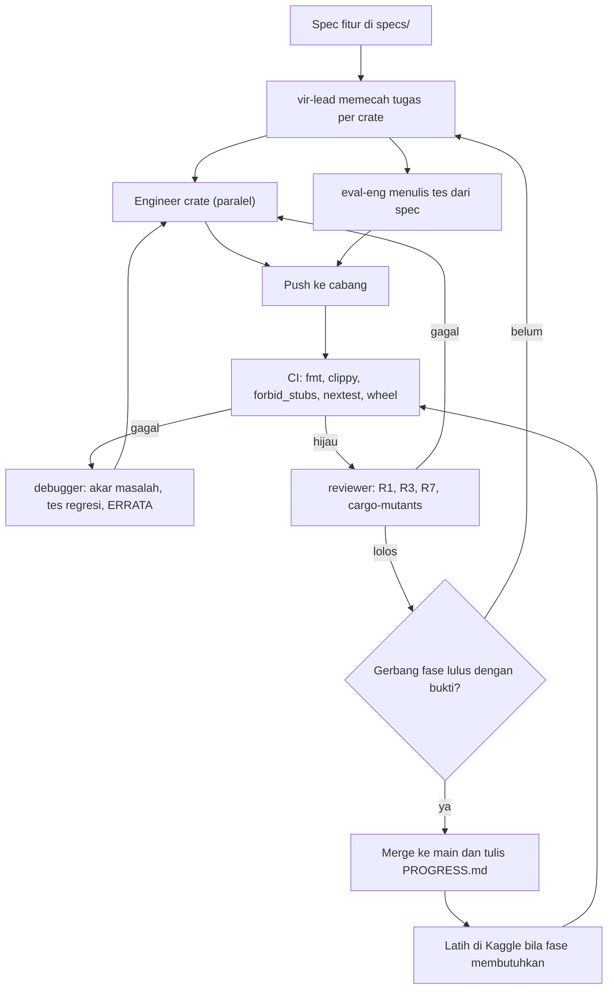
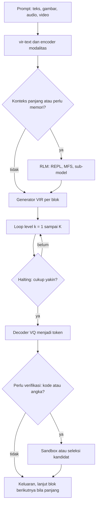
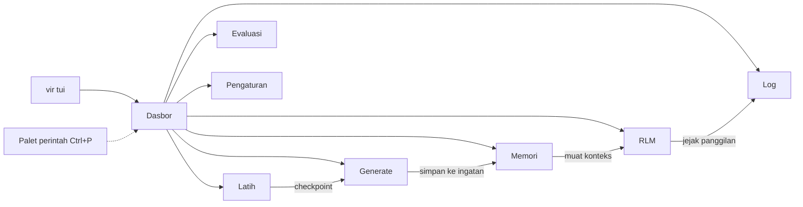
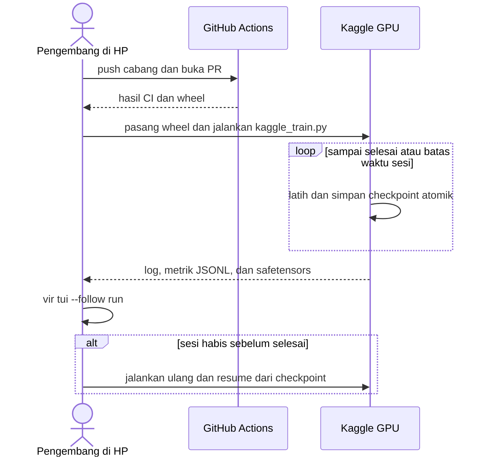
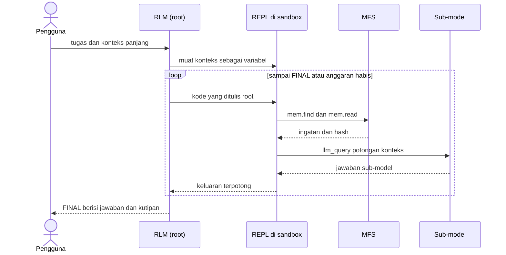
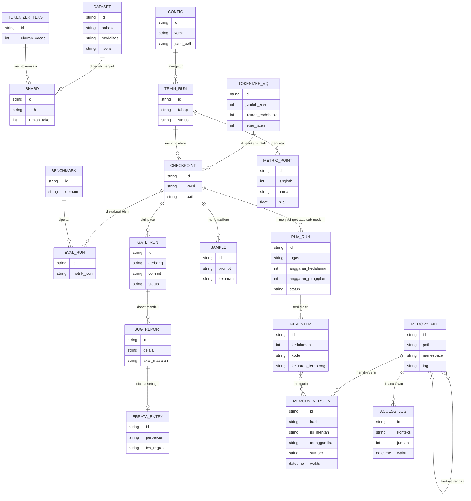
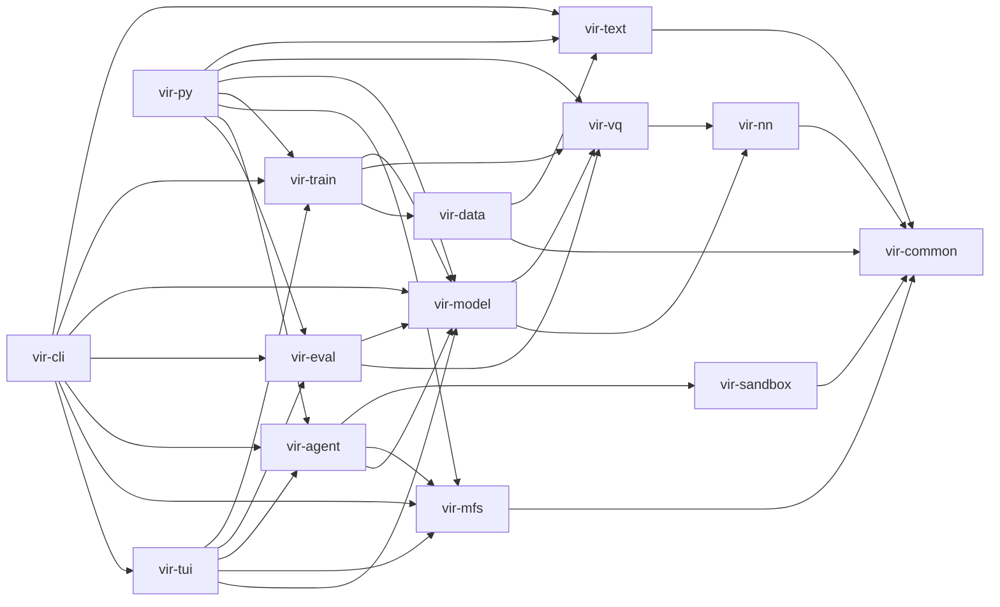
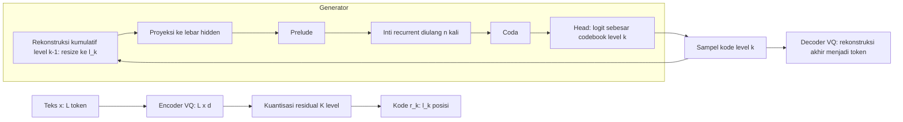

# PRD — VIR Vbeta (inti Rust, API Python)

> **VIR** = *Variable-depth Iterative Reasoner*. Versi: **Vbeta**.
> Dokumen ini menggantikan PRD versi Python. Repo dibuat ulang dari nol. Satu-satunya PRD; pecahan fase ada di dalam bagian Core Features.

---

## 1. Overview

### 1.1 Ringkasan
VIR adalah arsitektur model bahasa dari nol yang tidak mengikuti Transformer autoregresif klasik maupun MoE. Intinya:

- **NCM (Next-Concept Modeling)** sebagai generator: multiscale residual VQ-VAE mengubah teks menjadi hierarki kode diskret (kasar → halus), lalu sebuah transformer menghasilkan satu level sekaligus, semua posisi dalam level itu paralel.
- **Inti recurrent-depth** (prelude → blok yang diulang → coda) dengan **routing attention-residual gaya ARLoop** dan **pengendali halting** untuk reasoning.
- **Pembungkus block-autoregressive** untuk keluaran panjang, **RLM** untuk konteks panjang, dan **memori berbentuk file manager (MFS)** yang dipakai bersama RLM.
- Latihan pretrain → SFT → RL dengan reward yang bisa diverifikasi, plus seleksi kandidat saat inferensi.
- Multimodal berfase (lihat/generate gambar, dengar/buat audio, lihat video) dan target konteks 10 juta token jangka panjang.
- **Antarmuka terminal (TUI)** yang interaktif dan responsif untuk latihan, generate, memori, RLM, dan evaluasi.

**Cara membangunnya (baru):** seluruh inti ditulis dalam **Rust** (kerangka latihan: Burn), dan diekspos lewat **API Python** (PyO3 + maturin) serta **CLI** dan **TUI** (`vir tui`). Kompilasi dan tes berat berjalan di GitHub Actions dan Kaggle, bukan di HP.

### 1.2 Tujuan
1. Generate cepat tanpa mengorbankan kualitas.
2. Reasoning kuat.
3. Ahli koding.
4. Multibahasa: Indonesia, Inggris, Rusia, Jepang, dan lainnya.
5. Multimodal.
6. Konteks besar tetapi ringan (target jangka panjang 10 juta token).
7. Ukuran model dirahasiakan; rancangan tidak dibatasi untuk skala kecil.
8. **Semua yang ada di repo benar-benar berfungsi dan terintegrasi.**
9. **Antarmuka terminal yang bagus dipakai**, termasuk di layar HP.
10. Setiap lapisan memakai teknologi terbaik dan modern menurut bukti yang ada (bagian 6.1), dengan status jelas: Pakai, Evaluasi, atau Acuan.

### 1.3 Bukan tujuan Vbeta
- Menyamai LLM frontier.
- Generate video.
- Melayani banyak pengguna sekaligus (keunggulan kecepatan NCM diukur untuk satu pengguna).

### 1.4 Kenapa dibuat ulang, dan prinsip "selesai dulu"
Repo percobaan pertama hanya berisi kerangka: struktur ada, isinya tipis, dan sebagian modul tidak pernah benar-benar dijalankan. Pelajarannya menjadi aturan keras di PRD ini:

- **Irisan vertikal dulu.** Satu jalur penuh dari teks sampai teks (BPE → VQ-VAE → generator → decoder → sampling → latihan) harus bekerja nyata di skala mini sebelum fitur lain disentuh.
- **Tidak ada berkas tanpa isi nyata.** Berkas dibuat ketika isinya langsung berfungsi. Modul yang belum dikerjakan *tidak ada* di repo; tidak ada stub, `todo!()`, atau antarmuka kosong.
- **Setiap fitur lulus gerbang** (G0–G6, bagian 2.4) dengan bukti dari CI sebelum fitur berikutnya dimulai.
- **Integrasi dibangun bersamaan, bukan di akhir.** Tiap crate langsung dihubungkan ke API Python, CLI, dan tes ujung ke ujung.

### 1.5 Dasar bukti dan batasnya

| Komponen | Sumber | Status bukti |
|---|---|---|
| NCM | arXiv 2610.14162 | Generator ~100M parameter, skala sampai 725M di LM1B. Lebih cepat 10–31× dari baseline diffusion LM, bukan dari LLM autoregresif besar. Klaim Sudoku sebagian dipengaruhi urutan decoding. |
| Recurrent depth | arXiv 2502.05171 | Bukti di skala 3,5B dan data sangat besar. Di skala kecil belum pasti. |
| ARLoop | arXiv 2611.05234 (bukan 2610.11570, itu InfiLoop) | Routing attention-residual untuk looped transformer; diuji pada 140M, 370M, 0,6B, dan 1,2B, dengan keuntungan terbesar pada matematika dan kode. Belum diuji pada NCM atau mask block-diagonal. |
| RLM | MIT CSAIL | Strategi inferensi; root harus bisa menulis kode. |
| Model kode non-AR | Dream-Coder, Stable-DiffCoder, CoDA | Bukti dari diffusion LM, bukan NCM. |
| Burn (Rust) | github.com/tracel-ai/burn | Menurut ringkasan pihak ketiga (Okt 2026), Burn 0.22 memakai backend CubeCL (CUDA, ROCm, Metal, Vulkan, WebGPU, CPU), autodiff sebagai state runtime, Learner dengan checkpoint dan early stopping; backend LibTorch ditandai deprecated dan backend Candle dihapus. Kuantisasi hanya PTQ, belum QAT. **Kematangannya untuk model custom seperti VIR belum terbukti; itu diuji di G2.** |
| Throughput latihan Burn | Model card Kthulhu-0.1-150M (pihak ketiga) | Melaporkan Burn 0.22 dengan CubeCL 0.11 "stock" hanya 2.214 tok/s (7,3% dari PyTorch) pada transformer ~160M di RTX 3080 Ti, lalu dinaikkan lewat rekayasa kernel; mengklaim latihan dan inferensi tanpa Python atau PyTorch. Satu sumber dan laporan sendiri. |
| Kuantizer FSQ | arXiv 2309.15505; iFSQ arXiv 2601.17124 | FSQ tanpa codebook yang dipelajari: tanpa collapse dan tanpa commitment loss; ringkasan menyebut penurunan 0,5–3% dibanding VQ. FSQ residual punya masalah penyusutan residual yang sudah ada perbaikannya (RFSQ, iFSQ). Belum diuji pada NCM. |
| Optimizer Muon | Liu et al. 2025; arXiv 2502.16982 | Dilaporkan sekitar 2× efisiensi komputasi dibanding AdamW pada pretraining multi-miliar parameter; resep hibrid Muon (matriks tersembunyi) + AdamW (embedding, norm, head). Butuh grid learning rate sendiri. Belum diuji pada NCM atau skala kita. |
| Sandbox agen | Codex CLI, Cursor, Claude Code, Sandlock (arXiv 2605.26298) | Pola industri: Landlock + seccomp-bpf (Linux) atau bubblewrap, jaringan mati secara bawaan. |
| Memori agen | Memori, Spacebot, usulan di repo Hermes | Pola yang konvergen: SQLite + FTS5 + vektor dengan fusi RRF, dedup kosinus, dan peringkat berbobot akses. |
| Tokenizer cepat | Gigatoken; snaptokens | Gigatoken: 24,53 GB/s pada 144 core (pretokenizer SWAR tulisan tangan dan cache pretoken). snaptokens mengklaim rata-rata 2,19× lebih cepat dari Gigatoken (benchmark sendiri). Keduanya hanya untuk encode. |
| TUI | Ratatui 0.30.x dan ekosistemnya | Matang: widget bagan, gauge, sparkline, tabel; ratatui-image (sixel, kitty, iTerm2, halfblocks); tachyonfx; tui-textarea; tui-tree-widget. |
| Konteks ultra-panjang | Llama 4 Scout, Kimi Linear, MiniCPM-SALA | Klaim 10M ada, pemakaian efektif bervariasi. Hibrid linear + penuh/sparse terbukti sampai ~1M. |
| Multimodal diskret | AnyGPT, AR-Omni, NExT-OMNI | Belum ada yang menguji NCM. |

Kombinasi VIR belum pernah diuji pihak mana pun. Seluruh Vbeta adalah eksperimen terstruktur.

### 1.6 Nama
**VIR** — *Variable-depth Iterative Reasoner*: kedalaman (level dan loop) adaptif, penyempurnaan kasar → halus, fokus reasoning. **Vbeta** adalah versi eksperimen pertama.

---

## 2. Requirement

### 2.1 Kebutuhan fungsional

| ID | Kebutuhan |
|---|---|
| FR1 | Teks multibahasa: Indonesia, Inggris, Rusia, Jepang, dan lainnya |
| FR2 | Reasoning lewat recurrent depth dan halting |
| FR3 | Koding: FIM, eksekusi di sandbox, verifikasi unit test |
| FR4 | Keluaran panjang (block-AR) dan konteks panjang (RLM) |
| FR5 | Input multimodal: gambar, audio, video |
| FR6 | Output multimodal: gambar, audio |
| FR7 | Seleksi dan verifikasi kandidat saat inferensi |
| FR8 | Dikembangkan dari HP; kompilasi dan tes di Actions; latihan di Kaggle |
| FR9 | Konteks besar dan ringan; target jangka panjang 10 juta token |
| FR10 | Memori file manager (cari, buka, tautkan, versikan) dipakai bersama RLM |
| FR11 | **API Python** untuk seluruh kemampuan, plus **CLI** `vir` |
| FR12 | **Integrasi penuh**: model, tokenizer, memori, sandbox, RLM, latihan, dan evaluasi saling terhubung dan teruji ujung ke ujung |
| FR13 | **TUI** (`vir tui`): dasbor latihan, generate, penjelajah memori, penampil jejak RLM, evaluasi, log, dan pengaturan, plus mode `--plain` dan `--json` |

### 2.2 Aturan proyek (mengikat semua fase)

**R1. Kode seefektif mungkin**
- Ukur dulu, optimalkan kemudian. Perubahan di jalur panas menyertakan benchmark (`criterion`) sebelum/sesudah.
- Tanpa alokasi yang tidak perlu di jalur panas; operasi tensor di-batch; paralelisme data lewat `rayon`.
- Dependensi minimal dan berlisensi jelas (`cargo-deny`).

**R2. Bug pada arsitektur kita yang membenarkan**
- Bug di rancangan atau di kode acuan NCM diperbaiki di VIR pada akarnya, bukan ditambal gejalanya, dengan tes regresi dan satu entri di `docs/ERRATA.md`.

**R3. Kode tidak terlihat seperti vibe code**
- Satu tanggung jawab per modul; fungsi kira-kira ≤ 40 baris; berkas ≤ 400 baris.
- Tipe menjadi dokumentasi; komentar hanya menjelaskan *kenapa*; doc comment untuk API publik dengan bentuk tensor.
- Tanpa `unwrap`/`expect` di kode pustaka, tanpa kode mati, tanpa `println!` debug, tanpa angka ajaib (semua di `Config`).
- Penamaan mengikuti istilah paper (level k, ℓ_k, cumulative reconstruction).
- Dipaksa mesin (F0.2), bukan niat baik.

**R4. Fokus subagents OpenCode**
- Satu crate = satu wilayah tulis = satu subagen; konteks hanya spec dan crate terkait; handoff lewat berkas. Rincian di F0.3.

**R5. Versi dan nama**
- Nama VIR, versi Vbeta; setiap checkpoint dan artefak membawa label versi.

**R6. Tanpa HF Tokenizers**
- Tokenizer ditulis sendiri di Rust. Gigatoken, rustbpe, dan tokie hanya dipakai sebagai **pembanding** hasil dan kecepatan.

**R7. Selesai dulu, tanpa kerangka**
- Irisan vertikal sebelum perluasan. Tidak ada stub: `todo!()`, `unimplemented!()`, `NotImplementedError`, `TODO`, berkas atau crate kosong, dan tes yang hanya memeriksa impor ditolak CI.
- Pekerjaan yang belum selesai tinggal di cabang, bukan di `main`.
- Fitur berikutnya tidak dimulai sebelum gerbang fitur sebelumnya lulus dengan bukti CI.

**R8. Integrasi lengkap**
- Setiap crate publik langsung terhubung ke API Python (`vir-py`), CLI (`vir-cli`), dan satu tes ujung ke ujung. Fitur tanpa jalur pemakaian nyata dianggap belum selesai.

**R9. UI/UX terminal wajib bagus**
- **Responsif** di tiga lebar (sekitar 40, 80, dan 120 kolom; dari layar HP potret sampai desktop), **tidak pernah memblokir** (kerja berat di tugas latar), dan selalu menampilkan status penting (backend, throughput, run aktif, gerbang).
- **Konsisten**: satu peta tombol, palet perintah, bantuan `?`, dan pola yang sama di semua layar. **Tangguh**: terminal selalu dipulihkan saat panic, resize aman, tindakan merusak butuh konfirmasi dan bisa dibatalkan.
- **Dapat diakses**: `NO_COLOR` dihormati, palet ramah buta warna, mode kurangi gerak, dan mode `--plain` serta `--json` untuk skrip dan CI.
- **Terbukti**: tes snapshot per layar pada tiga ukuran dan tes input acak yang tidak boleh membuat panik (F3.8.h).

**R10. Teknologi terbaik dengan bukti**
- Pilihan teknologi per lapisan mengikuti bukti terbaru yang ditemukan (bagian 1.5 dan 6.1). Pilihan berstatus **Evaluasi** harus diputuskan lewat ADR dengan ablasi atau benchmark, bukan karena populer. Dependensi muda dan satu-sumber tidak dijadikan fondasi tanpa pembanding.

### 2.3 Lingkungan
- **HP (Termux)**: menyunting kode, `git`, OpenCode, membaca hasil CI lewat `gh`. **Tidak** mengompilasi Burn atau menjalankan tes berat.
- **GitHub Actions**: `cargo fmt`, `clippy`, tes, benchmark kecil, build wheel (manylinux x86_64), smoke CPU. Job punya batas waktu; verifikasi batas terbaru.
- **Kaggle (GPU)**: latihan. Wheel dipasang dari rilis atau dari dataset Kaggle. Sesi terbatas, sehingga checkpoint dan resume wajib.

### 2.4 Gerbang

| Gerbang | Isi | Bukti |
|---|---|---|
| **G0** | Workspace membangun wheel dari CI; `import vir` berjalan; gerbang anti-kerangka aktif | Run `wheels.yml` dan `ci.yml` hijau |
| **G1** | Irisan vertikal di CPU: BPE → kuantizer → generator → decoder → sampling. Rekonstruksi membaik per level; model mini menghafal ±8 sampel dan mereproduksinya **persis**; kuantizer dipilih lewat ablasi (residual FSQ vs VQ-EMA); dasbor TUI versi pertama berjalan | `vir smoke` di CI, kurva dan metrik terunggah, ADR kuantizer, snapshot TUI |
| **G2** | Burn berjalan di GPU Kaggle dengan model mini yang sama (dibatasi waktu), **dan throughput latihan diukur terhadap baseline PyTorch pada model dan GPU yang sama**; ambang diterima ditetapkan di ADR *sebelum* uji (usulan awal: tidak jauh di bawah separuh baseline) | Log notebook Kaggle, tabel tok/s, dan ADR keputusan |
| **G3** | Recurrent + halting + block-AR; latihan skala menghasilkan checkpoint yang bisa di-resume identik | Tes resume dan ablasi `n_loops` |
| **G4** | Integrasi penuh: `vir rlm` memakai model + MFS + sandbox; API Python, CLI, dan **TUI lengkap** | Suite `tests/e2e` dan snapshot TUI hijau |
| **G5** | Eval kode dan pass@k terukur; seleksi lewat verifier meningkatkan pass@k | Laporan eval di CI |
| **G6** | Konteks panjang efektif diukur (bukan hanya nominal) pada tiap kenaikan skala | Laporan F5.4 |

**Pintu keluar G2 (bukan rencana, hanya bila G2 gagal):** keputusan dicatat di ADR dan diambil pengguna. Opsi: (a) backend GPU lain yang didukung Burn (Vulkan/WebGPU), (b) menunggu atau memperbaiki dukungan CUDA di CubeCL, (c) memindahkan hanya bagian jaringan saraf ke kerangka lain lewat API Python sementara semua crate lain tetap Rust.

### 2.5 Risiko

| # | Risiko | Dampak | Mitigasi | Fitur |
|---|---|---|---|---|
| 1 | Burn belum matang untuk model custom, dan throughput latihan bisa jauh di bawah PyTorch (satu laporan pihak ketiga: 7,3% sebelum rekayasa kernel) | Waktu habis di infrastruktur, latihan terlalu lambat | G2 sedini mungkin dengan ambang throughput, rekayasa kernel (F7.1) bisa ditarik maju, ADR, pintu keluar | F1.9, F7.1 |
| 2 | Autodiff untuk operasi khusus (straight-through, EMA codebook) | Gradien salah | Tes numerik gradien terhadap diferensiasi hingga; tes properti | F1.4 |
| 3 | Rekonstruksi VQ-VAE lossy (angka, kode, entitas) | Jawaban atau kode rusak | Metrik rekonstruksi eksak, corruption, verifikasi eksekusi | F1.4, F4.4 |
| 4 | Halting belum punya resep | Loop boros | Bertahap: tetap → heuristik → terlatih | F2.2 |
| 5 | RL untuk NCM belum punya resep | Reasoning tidak naik | Seleksi saat tes dulu | F4.2, F4.3 |
| 6 | Waktu kompilasi Rust dan Burn lama | Siklus lambat | Crate kecil, cache Actions, `cargo nextest` | F0.5 |
| 7 | Sulit membaca hasil CI dari HP | Agen menebak | `gh` wajib, bukti diwajibkan | F0.3 |
| 8 | Linear attention lemah pada salin persis | Recall dan kode rusak | Selalu dihibrid dengan attention penuh; RLM untuk teks mentah | F5.2 |
| 9 | Konteks nominal 10M ≠ konteks efektif | Model gagal memakainya | Ukur konteks efektif; memori berjenjang | Fase 5 |
| 10 | Subagen saling menimpa atau konteks membengkak | Konflik, performa turun | Satu crate satu pemilik | F0.3 |
| 11 | Multimodal melebarkan lingkup | Proyek tak selesai | Fase terakhir, gerbang kualitas teks | Fase 6 |
| 12 | VQ-EMA rawan codebook collapse dan butuh banyak trik | Kualitas tokenizer rapuh | Ablasi dengan residual FSQ sejak G1 | F1.4.f |
| 13 | TUI berat atau lambat di Termux dan koneksi lambat | UI tersendat | Mode low-bandwidth, batas frame, render hanya saat ada perubahan, anggaran latensi diuji | F3.8 |
| 14 | Dependensi muda dan satu-sumber (snaptokens, burn_attention, SLT) | Rapuh atau berubah-ubah | Dipakai hanya di belakang trait dengan implementasi acuan sendiri dan tes kesetaraan | F1.2, F1.5, F3.8 |

### 2.6 Definisi selesai Vbeta
Angka adalah **target awal (hipotesis)** dan direvisi setelah fase terkait.

- **D1**: rekonstruksi VQ-VAE eksak pada teks campuran multibahasa, dan kode hasil rekonstruksi lolos parse hampir selalu (target awal ≥ 99%).
- **D2**: generator lebih cepat dari baseline AR seukuran dengan kualitas sebanding pada eval internal.
- **D3**: akurasi reasoning naik seiring jumlah loop sampai titik jenuh.
- **D4**: pass@1 dan pass@k terukur, dan seleksi lewat unit test meningkatkan pass@k.
- **D5**: CI hijau, `docs/ERRATA.md` mutakhir, semua PR melewati reviewer.
- **D6**: memori file manager menemukan dan mengutip ingatan lama dengan benar pada tes sintetis, dan membaca tidak pernah mengubah isi berkas.
- **D7**: seluruh jalur (teks → model → RLM/MFS/sandbox → keluaran) berjalan lewat satu perintah `vir` dan lewat API Python.

---

## 3. Core Features

**Format**: tiap fitur punya **Subagen** (pemilik), **Ide**, **Task list**, dan **Cara membuat** (langkah implementasi berurutan). Fitur kompleks punya subfitur dengan Ide, Task list, dan Cara membuat sendiri. Urutan: Fase 0 → 1 → 2 → 3 → 4; Fase 5, 6, dan 7 setelah G5. Setiap fase ditutup oleh gerbangnya.

### Rumus acuan dari arXiv

Rumus di bawah dipakai oleh bagian "Cara membuat". Status sumber: **dibaca langsung di sesi ini** = NCM (2610.14162, termasuk lampiran A, C, F), recurrent depth (2502.05171), ARLoop (2611.05234); **cuplikan makalah atau kutipan rumus yang konsisten di beberapa sumber** = FSQ (2309.15505), iFSQ (2601.17124), Muon (2502.16982), GRPO (2402.03300), pass@k (2107.03374), VAR/CFG (2404.02905), Kimi Linear (2510.26692), Parcae (2604.12946), ResFormer (2410.17897), Sandlock (2605.26298), RFSQ (2508.15860), SNAC (2410.14411), RULER (2404.06654); **belum diverifikasi** = RoPE (2104.09864), SigLIP, Whisper, Mimi/DAC, dan RRF (Cormack 2009). Koreksi rujukan: ARLoop adalah **2611.05234**, sedangkan 2610.11570 adalah InfiLoop; ID Muon 2509.23106 pada draf sebelumnya tidak ditemukan dan diganti 2502.16982.

| ID | Rumus | Sumber |
|----|-------|--------|
| R1 | `z_q^i = argmin_{e∈V} ‖z^i − e‖₂²` | NCM Pers. 1 |
| R2 | `u_k = Down_k(z^(k−1)) ∈ ℝ^{ℓ_k×d}`; `r_k^i = argmin_j ‖u_k^i − e_{k,j}‖²`; `ẑ^(k) = ẑ^(k−1) + R_k(e_k(r_k))`; `z^(k) = z − ẑ^(k)`; `ẑ^(0)=0`, `ℓ_1<…<ℓ_K=L` | NCM Pers. 3, 7, 8 |
| R3 | Nested dropout: `ẑ^(k) = Σ_{j≤k} R_j(e_j(r_j))`, cutoff k dicuplik saat latihan | NCM §3.3 |
| R4 | `L_tok = −(1/L)Σ_i log p_ψ(x^i∣ẑ^(k)) + β·MSE(z, sg[ẑ^(k)]) + MSE(sg[z], ẑ^(k))` | NCM Pers. 9 |
| R5 | `p_θ(r_{1:K}) = ∏_k ∏_{i=1}^{ℓ_k} p_θ(r_k^i ∣ ẑ^(k−1))` | NCM Pers. 4, 5 |
| R6 | `L_NCM = −Σ_k w_k Σ_i log p_θ(r_k^i ∣ z̃^(k−1))`, `w_k = ℓ_k^{−α} / Σ_j ℓ_j^{1−α}` | NCM Pers. 10 |
| R7 | `L_ELBO = Σ_n log p_ψ(x^n∣ẑ_*^(K)) + Σ_k Σ_i log p_θ(r_k^{*i}∣ẑ_*^(k−1))`; α=0 ⇒ loss generator = −(suku kedua)/N, N=Σℓ_k | NCM Lamp. A, Pers. 17 |
| R8 | `e=P(x)`, `s₀~N(0,σ²I)`, `s_i=R(e,s_{i−1})`, `p=C(s_r)`; `τ~N(log r̄ − σ²/2, σ)`, `r~Poisson(e^τ)+1`, σ=½; kedalaman efektif `l_P + r·l_R + l_C`; BPTT terpotong k=8 | Recurrent depth §3 |
| R9 | `x̂ = n₂(x + Attn(n₁(x)))`, `x = n₄(x̂ + MLP(n₃(x̂)))`; init varians `2/(5h)`, keluaran `1/(5h·l)`, skala embedding √h | Recurrent depth §3.2, §4.1 |
| R10 | `z_j=f_j(Norm(h_{j−1}))`; `α_{i,j}=softmax_{j∈{0..i}}(q_iᵀNorm(z_j))`; `h_i=α_{i,0}h₀+Σ_{j≥1}α_{i,j}z_j`; `b_k=Σ_{j=(k−1)S+1}^{kS}z_j`; jendela `B_W={b₀,b_{max(1,m−W+1)},…,b_m}` | ARLoop Pers. 2–4, §3.2 |
| R11 | FSQ: `round(⌊L/2⌋·tanh(z))` + STE, ukuran `∏L_i`, `idx=Σ(ẑ_i+⌊L_i/2⌋)·∏_{j<i}L_j`; iFSQ: `tanh → 2σ(1,6x) − 1` | FSQ; iFSQ |
| R12 | Muon: `X₀=M/‖M‖_F`; `X←aX+b(XXᵀ)X+c(XXᵀ)²X`, `(a,b,c)=(3,4445; −4,7750; 2,0315)`, 5 langkah; `W←W−η(0,2·√max(A,B)·O+λW)`; RMS update teoretis `√(1/max(A,B))` | Muon (Liu et al.) |
| R13 | NFE: `K` (tanpa guidance), `2K` (guidance), `K_c·K` (MBR); posisi diproses `Σℓ_k` | NCM Tabel 2, §4.6 |
| R14 | Anggaran token `Σ_tahap langkah×batch×L` | NCM Lamp. C.2 |
| R15 | pass@k: `1 − C(n−c,k)/C(n,k)` (1 bila n−c<k), stabil: `1 − ∏_{i=n−c+1}^{n}(1 − k/i)` | Codex, Pers. 1 |
| R16 | GRPO: `Â_i=(r_i−mean(r))/std(r)`; PPO-clip + `β·KL(π_θ‖π_ref)` di loss | DeepSeekMath |
| R17 | CFG level logit: `ℓ_uc + β(ℓ − ℓ_uc)`, β = 1+λ | VAR dan turunannya |
| R18 | KDA: `S_t=(I−β_t k_t k_tᵀ)Diag(α_t)S_{t−1}+β_t k_t v_tᵀ`; hibrid 3 KDA : 1 attention penuh (NoPE) | Kimi Linear |

**Hiperparameter acuan NCM** (Tabel 5 dan 6; model sekitar 100M):

| | TinyStories | LM1B | OWT |
|---|---|---|---|
| L (token target) / K level | 128 / 12 | 128 / 12 | 1.024 / 32 |
| \|V_k\| / d / blok dekoder | 4.096 / 384 / 1 | 8.192 / 384 / 4 | 4.096 / 384 / 1 |
| Nested dropout / EMA codebook | 0,5 / 0,95 | 0,7 penuh : 0,3 terpotong / 0,99 | 0,5 / 0,99 |
| Tokenizer: langkah × batch, LR | 30.000 × 4.096, 5·10⁻⁴ | 25.957 × 2.048, 3·10⁻⁴ | 78.432 × 768, 3·10⁻⁴ |
| Generator: blok / hidden / head | 12 / 768 / 12 | 12 / 768 / 12 | 12 / 768 / 12 |
| Generator: langkah × batch, RoPE | 50.000 × 2.048, 10⁵ | 100.000 × 512, 10⁴ | 250.000 × 256, 10⁵ |
| Parameter generator | 88,61M | 97,07M | 94,65M |

**Angka turunan yang sudah diverifikasi dengan hitungan di sesi ini:** jadwal linear K=12, L=128 menghasilkan `[1,13,24,36,47,59,70,82,93,105,116,128]` dengan Σℓ=774 (50,4% dari K·L=1536); anggaran token LM1B 13,36B dan OWT 127,22B cocok dengan makalah; NFE MBR/guidance XSum dan WMT14 cocok dengan Tabel 2; `f(1)=0,701` untuk koefisien Newton–Schulz sehingga hasil Muon bukan ortogonal eksak.


---

### FASE 0 — Fondasi yang Bisa Dibangun (gerbang G0)

#### F0.1 Workspace Rust dan wheel Python
**Subagen:** `bind-eng`, `eval-eng`

**Ide:** Satu workspace Cargo. Crate `vir-py` mengekspor modul `vir._core` lewat PyO3 (abi3), dibungkus paket Python tipis di `python/vir` dengan stub tipe. HP tidak mengompilasi; Actions membangun wheel dan mengunggahnya, Kaggle memasangnya.

**Task list:**
- [ ] Workspace, `rust-toolchain.toml` (versi terkunci), `Cargo.lock` dikomit
- [ ] `vir-common` dan `vir-py` dengan fungsi nyata pertama (versi dan info build)
- [ ] `pyproject.toml` maturin (abi3), paket `python/vir` dengan `py.typed`
- [ ] Workflow `wheels.yml` (manylinux x86_64), artefak diunggah
- [ ] Panduan memasang wheel di Kaggle (dataset Kaggle atau rilis GitHub)
- [ ] Tes CI: `pip install` wheel lalu `import vir`

**Cara membuat:**
1. Buat workspace Cargo (`[workspace]` dengan `resolver = "3"`), kunci versi di `rust-toolchain.toml`, dan komit `Cargo.lock`.
2. Tulis `vir-common` dengan satu fungsi nyata (`build_info()`), lalu `vir-py` yang mengekspornya sebagai `vir._core` lewat PyO3 dengan fitur `abi3`.
3. Tambahkan `pyproject.toml` (build-backend maturin, `module-name = "vir._core"`), `python/vir/__init__.py` yang tipis, `_core.pyi`, dan `py.typed`.
4. Tulis `wheels.yml` dengan `maturin-action` (manylinux x86_64) dan unggah wheel sebagai artefak.
5. Tambahkan job tes: pasang wheel di virtualenv bersih lalu jalankan `python -c "import vir; print(vir.build_info())"`. Tulis panduan pasang di Kaggle (dataset Kaggle atau rilis GitHub).

#### F0.2 Gerbang anti-kerangka otomatis
**Subagen:** `eval-eng`, `reviewer`

**Ide:** Kerangka dilarang oleh mesin. Clippy menolak `todo`, `unimplemented`, `dbg_macro`, serta `unwrap_used` dan `expect_used` di kode pustaka. Skrip `forbid_stubs.sh` menolak `todo!`, `unimplemented!`, `NotImplementedError`, `TODO`, `FIXME`, badan fungsi kosong, dan crate yang tidak punya tes. `reviewer` menjalankan `cargo-mutants` pada crate yang berubah untuk memastikan tes benar-benar bisa gagal.

**Task list:**
- [ ] Konfigurasi lint workspace dan `clippy.toml`
- [ ] `scripts/forbid_stubs.sh` dan langkahnya di CI
- [ ] Pemeriksa "crate punya tes yang dijalankan dan lebih dari nol"
- [ ] Templat PR dengan bagian **Bukti** wajib
- [ ] Prosedur `cargo-mutants` untuk reviewer
- [ ] `cargo-deny` untuk lisensi dan advisori dependensi

**Cara membuat:**
1. Atur `[workspace.lints]` (level `deny`) untuk `clippy::todo`, `unimplemented`, `dbg_macro`, `unwrap_used`, `expect_used`; `clippy.toml` mengizinkan `unwrap` hanya di tes.
2. Tulis `scripts/forbid_stubs.sh`: cari pola terlarang (`todo!`, `unimplemented!`, `NotImplementedError`, `TODO`, `FIXME`, badan fungsi kosong) dengan `rg`, keluar dengan kode non-nol bila ada temuan.
3. Tambahkan pemeriksa jumlah tes: `cargo nextest list` per crate harus lebih dari nol; jalankan di CI.
4. Buat `.github/pull_request_template.md` dengan bagian **Bukti** wajib (tautan run CI, benchmark, metrik).
5. Tulis prosedur reviewer `cargo mutants -p <crate>` dan `deny.toml` (lisensi yang diizinkan dan advisori) yang dijalankan lewat `cargo deny check`.

#### F0.3 Orkestrasi subagen OpenCode
**Subagen:** `vir-lead` (primary)

**Ide:** `vir-lead` memecah tugas, menulis spec, mendelegasikan, dan menggabungkan hasil; ia tidak menulis kode fitur. Format agen mengikuti dokumentasi OpenCode v2 (`.opencode/agents/*.md`, `mode: subagent`, `description`, `steps`); **verifikasi skema `permissions` ke https://v2.opencode.ai/agents.md**. Ada laporan isu bahwa agen kustom tidak bisa memanggil tool delegasi (github.com/anomalyco/opencode/issues/14308); cek di v2, dan bila terjadi, orkestrasi dijalankan dari agen primary bawaan. Pasang `gh` agar hasil CI bisa dibaca; **tanpa bukti CI, tugas tidak dianggap selesai.**

**Task list:**
- [ ] `AGENTS.md` (orientasi proyek)
- [ ] Berkas agen sesuai roster di bawah
- [ ] Verifikasi skema `permissions` dan kemampuan delegasi di v2
- [ ] Format spec per fitur `specs/<ID>.md` dengan kriteria tes
- [ ] Tugas uji delegasi dari ujung ke ujung
- [ ] Format laporan subagen (Diimplementasikan, Bukti, Selisih, Risiko)

**Cara membuat:**
1. Tulis `AGENTS.md` ringkas: tujuan, peta crate, aturan R1–R10, perintah build dan tes, lokasi spec.
2. Buat satu berkas per subagen di `.opencode/agents/` sesuai roster F0.3.a (`mode: subagent`, `description`, `steps`, wilayah tulis); cocokkan skema `permissions` dengan dokumentasi v2.
3. Uji delegasi ujung ke ujung dengan tugas kecil (misalnya satu fungsi di `vir-common`). Bila agen kustom tidak bisa memanggil tool delegasi, jalankan orkestrasi dari agen primary bawaan dan catat di ADR.
4. Tetapkan templat `specs/<ID>.md` (tujuan, trait antarmuka, kriteria tes, bukti yang diminta) dan format laporan subagen (Diimplementasikan, Bukti, Selisih, Risiko).
5. Pasang `gh` dan wajibkan laporan memuat tautan run CI.

##### F0.3.a Roster

| Subagen | Wilayah tulis | Tugas |
|---|---|---|
| `vir-lead` (primary) | `specs/`, `docs/` | Memecah tugas, spec, merge, `PROGRESS.md` |
| `arsitek` | `docs/adr/` | Desain dan ADR, baca saja untuk kode |
| `text-eng` | `crates/vir-text`, `crates/vir-data` | BPE, shard, streaming, FIM |
| `vq-eng` | `crates/vir-vq` | VQ-VAE multiscale |
| `nn-eng` | `crates/vir-nn` | RoPE, mask, attention, blok |
| `model-eng` | `crates/vir-model` | Generator, recurrent, halting, block-AR, sampling |
| `train-eng` | `crates/vir-train`, `scripts/` | Loss, trainer, checkpoint, skrip Kaggle |
| `mem-eng` | `crates/vir-mfs` | Memori file manager |
| `agent-eng` | `crates/vir-sandbox`, `crates/vir-agent` | Sandbox, REPL, RLM |
| `bind-eng` | `crates/vir-py`, `crates/vir-cli`, `python/` | API Python dan CLI |
| `ui-eng` | `crates/vir-tui` | TUI: tata letak, layar, tema, pengujian tampilan |
| `eval-eng` | `crates/vir-eval`, `tests/`, `.github/` | Tes, benchmark, CI (penulis tes ≠ penulis implementasi) |
| `debugger` | `docs/ERRATA.md`, tes regresi | Triase dan akar masalah |
| `reviewer` | tidak ada | Gerbang R1, R3, R7, uji mutasi |

##### F0.3.b Protokol delegasi
**Ide:** Aturan yang menjaga subagen cepat dan tidak saling timpa.

**Task list:**
- [ ] Satu tugas = satu crate = satu subagen; antarmuka antar crate lewat trait yang ditulis di spec lebih dulu
- [ ] Subagen hanya menerima spec dan berkas crate-nya
- [ ] Crate independen dikerjakan paralel; yang bergantung dikerjakan berurutan
- [ ] Handoff lewat berkas (spec, ADR, hasil benchmark), bukan ringkasan obrolan
- [ ] Batas `steps` per tugas; melebihi batas berarti tugas dipecah
- [ ] Satu gelombang per sesi; `docs/PROGRESS.md` ditulis di akhir tiap sesi

**Cara membuat:**
1. Tulis aturan protokol di `AGENTS.md` dan di prompt tiap subagen.
2. Wajibkan templat spec punya bagian "Trait antarmuka" yang ditulis sebelum implementasi dimulai.
3. `vir-lead` menyusun gelombang tugas dari graf ketergantungan crate (bagian 5.2): crate yang tidak saling bergantung dikerjakan paralel, sisanya berurutan.
4. Beri tiap tugas batas `steps`; bila habis sebelum selesai, tugas dipecah.
5. Akhiri tiap sesi dengan memperbarui `docs/PROGRESS.md` (selesai, bukti, sisa).

#### F0.4 Kebijakan koreksi bug arsitektur
**Subagen:** `debugger`, `arsitek`

**Ide:** Alur: reproduksi minimal → tes gagal → akar masalah → perbaikan → tes regresi → catatan di `docs/ERRATA.md`. Daftar pantau awal: kesalahan rekonstruksi eksak, jumlah level tetap, ketidakcocokan latihan dan inferensi, utilisasi codebook rendah.

**Task list:**
- [ ] Templat ERRATA dan templat laporan bug
- [ ] Konvensi tes regresi
- [ ] Daftar pantau awal (E-001 sampai E-004)
- [ ] Aturan: tidak ada perbaikan tanpa tes regresi

**Cara membuat:**
1. Buat `docs/ERRATA.md` dengan templat entri (ID, gejala, akar masalah, perbaikan, tes regresi, commit) dan templat laporan bug.
2. Tetapkan konvensi tes regresi: nama `regression_e00x_*` di `tests/` crate terkait.
3. Tulis E-001 sampai E-004 sebagai entri pantau lengkap dengan metrik pemicunya.
4. Tambahkan pemeriksa CI: PR berlabel `bugfix` harus menyentuh `ERRATA.md` dan minimal satu berkas tes.

#### F0.5 CI di GitHub Actions
**Subagen:** `eval-eng`

**Ide:** `ci.yml`: `fmt`, `clippy` (lint wajib), `cargo nextest`, `forbid_stubs`, `cargo-deny`. `wheels.yml`: build wheel. `smoke.yml`: `vir smoke` di CPU, mengunggah kurva loss dan metrik. Cache `cargo` dan `target` untuk menekan waktu kompilasi.

**Task list:**
- [ ] Tiga workflow di atas
- [ ] Cache dependensi
- [ ] Gerbang merge: seluruh workflow hijau plus persetujuan `reviewer`

**Cara membuat:**
1. Tulis `ci.yml`: job `fmt`, `clippy -D warnings`, `nextest`, `forbid_stubs`, `cargo deny`, dengan cache `sccache` atau `rust-cache`.
2. Gunakan `wheels.yml` dari F0.1 dan tulis `smoke.yml` yang menjalankan `vir smoke --json` lalu mengunggah kurva loss dan metrik sebagai artefak.
3. Atur proteksi cabang `main`: semua workflow hijau dan persetujuan `reviewer` sebelum merge.
4. Beri `timeout-minutes` tiap job dan verifikasi batas waktu Actions yang berlaku.

---

### FASE 1 — Irisan Vertikal Teks Mini (gerbang G1 dan G2)

Seluruh F1.x dikerjakan sebagai **satu irisan**: tiap crate selesai nyata, lalu langsung tersambung ke irisan ujung ke ujung (F1.8).

#### F1.1 `vir-common`: konfigurasi, galat, RNG
**Subagen:** `vir-lead`, `arsitek`

**Ide:** Fondasi bersama. `Config` bertingkat (serde) dengan validasi ketat (jadwal ℓ_k tidak menurun dan ℓ_K = L; lebar hidden habis dibagi jumlah head). Tipe galat terstruktur. RNG deterministik agar tes dan resume bisa direproduksi. Pembuat jadwal ℓ_k: linear, kuadrat, akar, log, eksponensial, kosinus.

**Task list:**
- [ ] `Config` dan validasi dengan pesan galat jelas
- [ ] Tipe galat terstruktur
- [ ] RNG deterministik dan utilitas seed
- [ ] Jadwal ℓ_k dengan tes properti (`proptest`) untuk semua jenis dan banyak nilai L, K

**Cara membuat:**
1. Tulis `ModelConfig` dengan field ℓ_k terhitung dari `L`, `K`, dan jenis jadwal: `ℓ_k = round(1 + (L−1)·g((k−1)/(K−1)))`, `g(t)` = `t` (linear), `t²`, `√t`, dan seterusnya. NCM Lampiran F.1.2 hanya menyebut enam nama jadwal (linear, kuadrat, akar, log, eksponensial, kosinus) dengan K=12, mulai 1 kode, berakhir 128; bentuk `g` untuk empat jadwal terakhir adalah definisi VIR dan dicocokkan dengan `HazyResearch/ncm`.
2. Uji hitung tangan jadwal linear K=12, L=128: `[1, 13, 24, 36, 47, 59, 70, 82, 93, 105, 116, 128]`, jumlah ℓ_k = 774 posisi (R13). Uji juga XSum (L=48, K=8: jumlah 196) dan WMT14 (L=64, K=11: jumlah 357).
3. `validate()` menolak: ℓ_k tidak naik ketat, ℓ_K ≠ L, `hidden % heads ≠ 0`, dan `hidden/heads ≠ 64` bila `strict_paper=true` (NCM memakai dimensi head 64, Lampiran C.2).
4. Titik awal konfigurasi mini diturunkan dari baris TinyStories (NCM Tabel 5–6): K=12, |V_k|=4096, d=384, L=128, lalu dikecilkan (K, d, dan hidden) agar muat di CPU CI.

#### F1.2 `vir-text`: BPE di Rust
**Subagen:** `text-eng`

**Ide:** Tokenizer BPE tingkat byte tanpa HF Tokenizers: pra-tokenisasi aman untuk Jepang dan Rusia, pelatihan paralel (`rayon`) dari iterator korpus (pendekatan rustbpe), `decode`, token khusus (PAD, BOS, EOS, MASK, penanda FIM, cadangan modalitas), dan ekspor ke format tiktoken. Untuk `encode` ada tiga lapis: (1) implementasi acuan sendiri dengan jaminan waktu linear bahkan pada masukan adversarial (pola rs-bpe), dipakai untuk tes dan sebagai cadangan; (2) backend cepat **snaptokens** (crate Rust), dan (3) **Gigatoken**. Keduanya cepat karena pretokenizer tulisan tangan dan cache pretoken, bukan karena loop merge yang lebih cepat, dan keduanya hanya untuk encode; snaptokens baru dan klaim kecepatannya dari benchmark sendiri, jadi dipakai di belakang trait `Encoder` dengan tes kesetaraan terhadap implementasi acuan.

**Task list:**
- [ ] Pra-tokenisasi dan pelatihan BPE paralel
- [ ] `encode` dan `decode` tanpa kehilangan (byte-level)
- [ ] Ekspor tiktoken dan pemuat
- [ ] Tes round-trip: Indonesia, Inggris, Rusia, Jepang, emoji, kode, byte acak
- [ ] Trait `Encoder` dengan implementasi acuan sendiri, lalu backend opsional snaptokens dan Gigatoken (periksa lisensi, format masukan, dan kematangan)
- [ ] Tes: keluaran semua backend identik pada korpus uji, termasuk masukan adversarial
- [ ] Benchmark `criterion` antar backend pada korpus yang sama; backend produksi dipilih lewat ADR

**Cara membuat:**
1. Pra-tokenisasi di tingkat byte dengan pemisah yang aman untuk skrip tanpa spasi (Jepang) dan Cyrillic (Rusia); daftarkan token khusus di `special.rs`.
2. Pelatih BPE: hitung frekuensi pra-token paralel dengan `rayon`, lalu gabungkan pasangan paling sering berulang kali dengan indeks pasangan yang diperbarui bertahap (`train.rs`, `bpe.rs`).
3. Encoder acuan berbasis rank dengan waktu linear (heap atau linked list) sebagai cadangan sekaligus oracle tes.
4. `decode` = penyambungan byte tiap token; tulis ekspor dan pemuat format tiktoken (`export.rs`).
5. Definisikan trait `Encoder`; tambahkan backend snaptokens dan Gigatoken di belakang feature flag setelah cek lisensi dan format masukan. Uji kesetaraan dengan implementasi acuan (`proptest` dan korpus adversarial), benchmark `criterion`, lalu pilih backend lewat ADR.

#### F1.3 `vir-data`: shard, streaming, FIM
**Subagen:** `text-eng`

**Ide:** Pipeline data nyata: penulis dan pembaca shard biner, urutan deterministik berdasarkan seed dengan status yang bisa dilanjutkan, pengemasan ke blok panjang tetap, bobot campuran bahasa, dan transformasi FIM untuk kode. Untuk tes, korpus kecil berbasis domain publik plus generator sintetis berstruktur (aritmetika, kode sederhana, kalimat templat multibahasa).

**Task list:**
- [ ] Format shard, penulis, dan pembaca streaming
- [ ] Urutan deterministik dan resume
- [ ] Pengemasan blok dan campuran bahasa
- [ ] Transformasi FIM (PSM dan SPM) dengan tes reversibel
- [ ] Korpus tes dan generator sintetis; `data/sources.json` berisi sumber dan lisensi nyata

**Cara membuat:**
1. Format shard: header (versi, dtype, jumlah token) diikuti blok token terkompres `zstd`; penulis di `shard.rs`, pembaca berbasis `memmap2`.
2. `stream.rs`: iterator dengan urutan acak deterministik dari seed; simpan state (indeks shard, offset, state RNG) agar resume tepat.
3. `pack.rs`: kemas ke blok panjang tetap dengan pemisah EOS dan mask padding; `mix.rs`: ambil sampel antar sumber menurut bobot bahasa.
4. `fim.rs`: transformasi PSM dan SPM dengan token FIM; tes bahwa transformasi bisa dibalik.
5. `synth.rs`: generator sintetis (aritmetika, kode sederhana, kalimat templat multibahasa); isi `data/sources.json` dengan sumber dan lisensi nyata.

#### F1.4 `vir-vq`: VQ-VAE multiscale
**Subagen:** `vq-eng`

**Ide:** Token BPE (panjang L) dikodekan menjadi K level kode diskret dengan panjang ℓ_1 < … < ℓ_K = L. Level awal membawa gagasan kasar, level akhir membawa detail. Berbeda dari paper (satu tokenizer per dataset), Vbeta mencoba satu VQ-VAE untuk semua bahasa dan domain; bila utilisasi codebook atau rekonstruksi buruk, cadangannya tokenizer per domain. Dilatih dulu, lalu dibekukan. Tata letak dan detail mengikuti paper NCM dan kode HazyResearch/ncm; selisih dicatat di ADR.

**Task list:**
- [ ] ADR tata letak (dari paper dan kode acuan) sebelum implementasi
- [ ] Antarmuka `encode` dan `decode` yang bertipe
- [ ] Integrasi ke `vir-train` tahap 1

**Cara membuat:**
1. Baca NCM §3.1–3.3 dan Lampiran C.1; rumus yang diimplementasikan adalah R1–R4 di bagian "Rumus acuan". Perhatikan: pada seluruh enam konfigurasi NCM, **encoder = 0 blok transformer** (hanya tabel embedding token yang memetakan x ke `z ∈ ℝ^{L×d}`, d=384), sedangkan dekoder 1 blok (4 blok untuk LM1B, 6 head).
2. Urutan rakit: codebook per level (a) → turun/naik skala dan residual (b) → nested dropout (c) → dekoder dan loss R4 (d) → evaluasi (e); kuantizer FSQ (f) di belakang trait `Quantizer` yang sama.
3. Tulis ADR dengan angka awal dari NCM Tabel 5: |V_k| = 4096 (8192 untuk LM1B), d = 384, EMA decay 0,95–0,99, dropout 0,1–0,3, K = 12 untuk L=128.
4. Hitung ukuran codebook sebelum melatih: `params = K·|V_k|·d`; OWT 32·4096·384 = 50.331.648, LM1B 12·8192·384 = 37.748.736 (bagian dari total 111,2M dan 111,4M yang dilaporkan, sisanya embedding dan dekoder).

##### F1.4.a Codebook
**Ide:** Kuantisasi terdekat, pembaruan EMA, restart kode mati, straight-through estimator, statistik utilisasi dan perplexity.

**Task list:**
- [ ] Codebook dengan EMA dan restart kode mati
- [ ] Straight-through dengan tes gradien terhadap diferensiasi hingga
- [ ] Statistik utilisasi dan perplexity

**Cara membuat:**
1. Quantisasi R1: `z_q^i = argmin_{e∈V} ‖z^i − e‖₂²`; implementasi batch: `‖z‖² − 2·z·Eᵀ + ‖E‖²` lalu `argmin`.
2. Update codebook dengan EMA (decay 0,99 untuk OWT dan LM1B, 0,95 untuk TinyStories, XSum, WMT14; NCM Tabel 5): `N_j ← γN_j + (1−γ)n_j`, `m_j ← γm_j + (1−γ)Σ z`, `e_j = m_j/N_j`. Restart kode mati dengan sampel dari batch.
3. Straight-through (NCM §3.3): `z + (z_q − z).detach()`; uji gradien terhadap diferensiasi hingga.
4. Metrik utilisasi: persen entri terpakai minimal sekali dan perplexity histogram kode terhadap ukuran codebook (NCM Gambar 16). Pembanding arah: NCM Tabel 1 melaporkan utilisasi rata-rata 61,9–90,1% dan akurasi rekonstruksi 98,79–100%.

##### F1.4.b Kuantisasi residual multiscale dan operator R_k
**Ide:** Tiap level mengkuantisasi sisa dari rekonstruksi kumulatif setelah diturunkan ke ℓ_k posisi (pooling yang menghormati padding); operator R_k menaikkannya kembali ke L untuk ditambahkan.

**Task list:**
- [ ] Operator turun dan naik
- [ ] Rekonstruksi kumulatif per level
- [ ] Tes invarian: rekonstruksi level K mendekati laten asli pada data kecil

**Cara membuat:**
1. Per level k (R2): `u_k = Down_k(z^(k−1)) ∈ ℝ^{ℓ_k×d}`, `r_k^i = argmin_j ‖u_k^i − e_{k,j}‖²`, `ẑ^(k) = ẑ^(k−1) + R_k(e_k(r_k))`, `z^(k) = z − ẑ^(k)`, dengan `ẑ^(0) = 0` dan `z^(0) = z`. `R_k` memetakan `ℓ_k×d` ke `L×d`; makalah NCM hanya menyebut "operator rekonstruksi", sehingga pilihan Down/R_k (pooling dan interpolasi, atau konvolusi seperti VAR) ditetapkan lewat ADR.
2. Simpan `r_k` dan `ẑ^(k)` tiap level (dipakai generator, R5–R6).
3. Tes invarian: `Σ_k R_k(e_k(r_k)) = ẑ^(K)`; galat `‖z − ẑ^(k)‖` tidak naik per level pada data kecil setelah dilatih.
4. Kandidat `Down_k`/`R_k` dari SNAC (arXiv 2410.14411): turunkan residual dengan average pooling faktor `W_k`, cari kode, lalu naikkan dengan nearest-neighbor faktor `W_k` ke resolusi asal; SNAC juga menyuntikkan blok derau yang menurut ablasinya memperbaiki rekonstruksi dan utilisasi codebook. Bandingkan dengan interpolasi linear lewat ADR.

##### F1.4.c Nested dropout
**Ide:** Saat latihan, hanya k level pertama yang dipakai (k acak), agar level awal membawa informasi bermakna.

**Task list:**
- [ ] Sampler cutoff dan masking
- [ ] Ablasi probabilitas dropout

**Cara membuat:**
1. Nested dropout (NCM §3.3, R3): saat latihan hanya k level pertama dipakai: `ẑ^(k) = Σ_{j≤k} R_j(e_j(r_j))`, dan seluruh suku loss R4 dihitung pada cutoff itu.
2. Konfigurasi makalah (Tabel 5): peluang menjatuhkan level halus = 0,5 (TinyStories, OWT, XSum, WMT14, Sudoku); LM1B melatih hierarki penuh dan terpotong dengan bobot 0,7 dan 0,3. Distribusi tepat `k` saat terpotong tidak tertulis di teks yang dibaca; cek kode acuan dan jadikan parameter `Config`.
3. Ablasi peluang dropout (0; 0,3; 0,5; 0,7) pada akurasi rekonstruksi per level.

##### F1.4.d Decoder dan loss
**Ide:** Decoder kecil (1–4 blok) memetakan rekonstruksi akhir ke logit vocab di semua L posisi. Cross-entropy dengan vocab besar dihitung **per potongan** agar logit penuh tidak dibentuk sekaligus.

**Task list:**
- [ ] Decoder dan kepala softmax
- [ ] Cross-entropy per potongan dengan tes kesetaraan terhadap versi penuh
- [ ] Loss rekonstruksi dan komitmen

**Cara membuat:**
1. Dekoder (R4): `p_ψ(x^i | ẑ^(k))` di semua L posisi dari rekonstruksi kumulatif. Loss tokenizer: `L_tok = −(1/L)·Σ_i log p_ψ(x^i∣ẑ^(k)) + β·MSE(z, sg[ẑ^(k)]) + MSE(sg[z], ẑ^(k))`; suku kedua komitmen, suku ketiga kuantisasi laten, `sg` = stop-gradient.
2. Nilai `β` tidak terbaca di bagian makalah yang diperiksa; jadikan hiperparameter dan cocokkan dengan `HazyResearch/ncm`. Dengan FSQ (F1.4.f) kedua suku MSE dihilangkan (FSQ tidak butuh loss tambahan).
3. Hitung CE per potongan dan jumlahkan, dengan checkpointing agar tensor logit `L×|vocab|` tidak disimpan (vocab sampai 151.680 pada WMT14). Tes kesetaraan nilai dan gradien terhadap CE penuh.

##### F1.4.e Evaluasi rekonstruksi
**Ide:** Akurasi token saja tidak cukup untuk reasoning dan kode. Metrik harus eksak dan sadar domain.

**Task list:**
- [ ] Akurasi rekonstruksi eksak per bahasa
- [ ] Laju parse kode hasil rekonstruksi
- [ ] Kesalahan pada angka, entitas, diakritik (per kategori)
- [ ] Utilisasi codebook per level
- [ ] Keputusan lanjut atau mundur ke tokenizer per domain, dicatat di ADR

**Cara membuat:**
1. Akurasi rekonstruksi eksak per level: dekode `ẑ^(k)` untuk k=1..K lalu bandingkan argmax token dengan input (NCM Lampiran G, Gambar 16). Target arah: 99,86–99,99% pada level penuh untuk teks (Tabel 1), 100% untuk tugas yang menuntut eksak seperti Sudoku.
2. Kategori kesalahan yang dicatat NCM (Tabel 11): entitas bernama, diakritik, angka, nama pengguna, markup, batas kata. Klasifikasikan selisih token ke kategori itu dan tambahkan kategori "kode gagal parse".
3. Utilisasi dan perplexity kode per level ke JSON untuk TUI.
4. Gerbang: bila akurasi level penuh jauh di bawah ±99,8% pada korpus tes VIR, tulis ADR keputusan (vocab dekoder, K, ukuran codebook, atau tokenizer per domain; NCM juga melatih satu tokenizer per dataset).

##### F1.4.f Kuantizer alternatif: residual FSQ
**Ide:** Finite Scalar Quantization memproyeksikan laten ke beberapa dimensi (biasanya kurang dari 10) lalu membulatkan tiap dimensi ke himpunan nilai tetap, sehingga tidak ada codebook yang dipelajari, tidak ada commitment loss, dan tidak ada codebook collapse. Pada kuantisasi residual, residual menyusut di tahap-tahap akhir; perbaikannya berupa penskalaan terpelajar per tahap dan layer norm yang bisa dibalik (RFSQ), atau fungsi aktivasi yang mencocokkan distribusi (iFSQ). Karena risiko collapse pada VQ-EMA nyata (risiko 12), kedua pendekatan diablasi pada G1 dan dipilih lewat ADR. Ini selisih dari paper NCM yang memakai VQ, jadi dicatat sebagai ADR.

**Task list:**
- [ ] Kuantizer residual FSQ di belakang trait yang sama dengan `Codebook`
- [ ] Penskalaan per tahap dan normalisasi yang bisa dibalik, diuji dengan tes invarian
- [ ] Ablasi FSQ residual vs VQ-EMA: akurasi rekonstruksi eksak, utilisasi, stabilitas latihan
- [ ] ADR pemilihan kuantizer

**Cara membuat:**
1. FSQ (arXiv 2309.15505): `f(z) = ⌊L/2⌋·tanh(z)` lalu `round` dengan STE (`z + (round(z) − z).detach()`), ukuran codebook implisit `∏ L_i`; proyeksikan laten ke d < 10 dimensi. Versi kode acuan: `half_l = (L−1)(1+ε)/2`, `offset = 0,5` bila L genap (selain itu 0), `shift = atanh(offset/half_l)`, `bound(z) = tanh(z + shift)·half_l − offset`, ε = 10⁻³.
2. Indeks kode = bilangan berbasis campuran: `idx = Σ_i (ẑ_i + ⌊L_i/2⌋)·b_i`, `b_i = ∏_{j<i} L_j`. Pilihan level yang direkomendasikan makalah: `[8,5,5,5]` ≈ 2¹⁰ (1000), `[8,8,6,5]` ≈ 2¹¹, `[7,5,5,5,5]` ≈ 2¹² (4375), `[8,8,8,6,5]` ≈ 2¹⁴; L_i ≥ 5 per dimensi disarankan. Untuk |V_k| = 4096 seperti NCM, kandidat: `[7,5,5,5,5]` (4375).
3. iFSQ (arXiv 2601.17124): ganti `tanh` dengan `y = 2σ(1,6x) − 1` agar aktivasi mendekati seragam; temuan mereka: titik optimum sekitar 4 bit per dimensi. Hitungan turunan VIR: 4 bit × 3 dimensi = 12 bit = `[16,16,16]` = 4096, tepat sama dengan |V_k| NCM. Ini hipotesis uji (hasil iFSQ berasal dari gambar), bukan klaim makalah.
4. RFSQ (Zhu et al., arXiv 2508.15860): FSQ residual naif mengalami peluruhan magnitudo residual (contoh makalah: bila `r₃` berukuran 10⁻³ padahal batas FSQ dirancang untuk skala satu, resolusi efektif turun tiga orde besar). Strategi 1, skala belajar: `q_k = FSQ_k(α_k·r_{k−1})`, `r_k = r_{k−1} − q_k/α_k`, dengan `α_k` belajar dan diinisialisasi 1,0. Strategi 2, LayerNorm yang bisa dibalik: `r̂_{k−1} = LayerNorm(r_{k−1})`, `q_k = FSQ_k(r̂_{k−1})`, `r_k = r_{k−1} − LayerNorm⁻¹(q_k)` (simpan statistik normalisasi untuk inversi). Pada ImageNet LayerNorm paling konsisten: +9,7% L1 dan +17,4% perceptual dibanding varian tanpa kondisi, serta hingga 28,7% L1 dan 45% perceptual lebih baik dari VQ-EMA, FSQ, dan LFQ. Hasil itu dari gambar dan audio, bukan teks, jadi ujikan di VIR.
5. Ablasi pada tokenizer mini: VQ-EMA vs FSQ `[7,5,5,5,5]` vs iFSQ `[16,16,16]` pada akurasi rekonstruksi eksak, utilisasi, dan stabilitas; tulis ADR.

#### F1.5 `vir-nn`: komponen jaringan
**Subagen:** `nn-eng`

**Ide:** Komponen jaringan di atas Burn, ditulis sekali dan dipakai ulang: RoPE, mask (block-diagonal dan prefix-LM), attention, RMSNorm, FFN SwiGLU, blok pre-norm. Attention memakai pola block-diagonal karena di ablasi paper memberi kualitas terbaik sekaligus tercepat. Dimulai dengan attention berbasis matmul dan softmax; kernel terfusi menyusul di F7.1.

**Task list:**
- [ ] RoPE dengan tes properti: q·k hanya bergantung pada selisih posisi
- [ ] Mask block-diagonal dan prefix-LM
- [ ] Attention multi-head dengan padding dan panjang variabel
- [ ] RMSNorm, SwiGLU, blok pre-norm
- [ ] QK-Norm sebagai opsi konfigurasi untuk menstabilkan attention (diablasi)
- [ ] Attention lewat operasi attention Burn bila tersedia di backend (burn-flex memilih otomatis antara versi naif dan tiled flash); bila tidak, matmul + softmax dengan mask. Crate `burn_attention` (FA3, masih v0.1) tidak dijadikan fondasi
- [ ] Tes gradien dan ketiadaan NaN

**Cara membuat:**
1. RoPE (arXiv 2104.09864; rumus dari makalah itu belum dibuka di sesi ini): rotasi pasangan dimensi `(2m, 2m+1)` dengan sudut `pos·θ^(−2m/d)`; basis θ = 10⁴ atau 10⁵ (NCM Tabel 6), 5·10⁴ pada Huginn. Properti uji: `⟨R_p q, R_s k⟩` hanya bergantung pada `p − s`.
2. Mask block-diagonal (NCM Gambar 11d, Tabel 9): token level k hanya melihat blok level k; input blok sudah merangkum level sebelumnya lewat `ẑ^(k−1)`. NCM melaporkan pada TinyStories: block-diagonal Gen. PPL 15,41 dan 5,65 s, block-causal 19,63 dan 7,90 s (1,40×), jendela 2 level 17,84 dan 6,83 s (1,21×).
3. Mask prefix-LM untuk kondisional (NCM §3.4): prompt saling melihat; tiap blok target melihat prompt dan dirinya sendiri; prompt tidak melihat target.
4. Dimensi head 64 (hidden 768 / 12 head); RMSNorm, SwiGLU, dan QK-Norm opsional. Perkiraan jumlah parameter per blok `≈ 12·h²` (FFN 4×): 12 blok × 12 × 768² ≈ 85M, sebagai pemeriksa kewajaran terhadap 88,6–97,1M yang dilaporkan NCM (embedding dan lainnya menambah sisanya).

##### F1.5.a Tes tanpa kebocoran
**Ide:** Bukti bahwa mask benar: mengubah token di blok lain tidak mengubah keluaran blok ini, dan pada prefix-LM prompt tidak terpengaruh blok target.

**Task list:**
- [ ] Uji gangguan untuk block-diagonal
- [ ] Uji gangguan untuk prefix-LM

**Cara membuat:**
1. Tes kebocoran (invarian dari mask Gambar 11d): ubah satu token di blok level j≠k; keluaran blok k harus identik bit-demi-bit.
2. Untuk prefix-LM: ubah token target; keluaran posisi prompt tidak boleh berubah.
3. Jalankan pada ukuran blok dari jadwal nyata (misalnya `[1,13,24,…,128]`).

#### F1.6 `vir-model` (inti): generator NCM dan sampling
**Subagen:** `model-eng`

**Ide:** Input generator berasal dari rekonstruksi kumulatif, jadi embedding utamanya adalah tabel codebook per level ditambah RoPE. Pada level k, rekonstruksi level sebelumnya di-resize ke ℓ_k posisi lalu diproyeksikan ke lebar hidden; satu forward pass memprediksi semua kode level itu. Generasi berjalan level demi level, lalu decoder VQ menghasilkan token. Head per level atau bersama diputuskan lewat ADR setelah memeriksa kode acuan.

**Task list:**
- [ ] Embedding kode per level dan proyeksi rekonstruksi kumulatif
- [ ] Generator dan head
- [ ] Sampling level demi level (temperature, top-k), deterministik dengan seed
- [ ] API `loss(batch)` dan `generate(prompt, ...)`

**Cara membuat:**
1. Faktorisasi (R5): `p_θ(r_{1:K}) = ∏_k p_θ(r_k | ẑ^(k−1))`, dan dalam satu level kode independen bersyarat `∏_{i=1}^{ℓ_k} p_θ(r_k^i ∣ ẑ^(k−1))` (NCM Pers. 4–5), sehingga satu forward menghasilkan seluruh ℓ_k kode.
2. Masukan level k: `ẑ^(k−1)` di-resize ke ℓ_k posisi lalu diproyeksikan ke lebar hidden (Algoritma 1 dan 2). Keluaran: logit sebesar |V_k| per posisi.
3. Latihan (Algoritma 1): kode target `r_{1:K}` dari tokenizer beku, ganti sebagian kode masukan menjadi `r̃` (corruption, F1.7), bangun `z̃^(k) = z̃^(k−1) + R_k(e_k(r̃_k))`, prediksi semua level dalam satu forward dan hitung `L_NCM` (R6) terhadap kode bersih.
4. Generate (Algoritma 2): untuk k=1..K: resize `ẑ^(k−1)`, forward, sampel semua ℓ_k kode paralel, `ẑ^(k) = ẑ^(k−1) + R_k(e_k(r_k))`; setelah level K dekode `ẑ^(K)` dan ambil argmax tiap token.
5. Biaya: NFE = K (satu forward per level); posisi yang diproses = Σℓ_k (774 untuk jadwal linear K=12, L=128, atau 50,4% dari K·L = 1536 bila tiap langkah memproses semua posisi seperti difusi).
6. Tes: determinisme pada seed sama, loss turun pada data kecil, dan kecocokan `p_θ` yang dihitung tangan pada vocab 2 kode.

#### F1.7 `vir-train`: latihan
**Subagen:** `train-eng`

**Ide:** Latihan dua tahap: tahap 1 melatih VQ-VAE sampai lolos gerbang rekonstruksi, tahap 2 membekukannya dan melatih generator. Termasuk corruption pada kode input, loss berbobot level, jadwal LR, clipping, checkpoint atomik, dan resume yang menghasilkan langkah berikutnya identik. Optimizer: **Muon** untuk matriks tersembunyi dan **AdamW** untuk embedding, norm, dan head (resep hibrid yang kini umum), dengan grid learning rate terpisah karena optimum Muon jauh lebih rendah dari AdamW. Muon ditulis sendiri (ortogonalisasi Newton–Schulz) dengan tes numerik, dan dibandingkan dengan AdamW murni pada skala mini sebelum dipakai.

**Task list:**
- [ ] Loss berbobot level (α), mengabaikan padding, per potongan
- [ ] Corruption dengan jadwal per level; tes laju sebenarnya mendekati target
- [ ] Trainer dua tahap dengan gerbang metrik rekonstruksi
- [ ] Checkpoint atomik dan **tes resume identik**
- [ ] Log metrik JSONL (dibaca langsung oleh TUI)
- [ ] Optimizer Muon + AdamW hibrid dan perbandingan dengan AdamW murni pada skala mini
- [ ] Jadwal LR (kosinus dan warmup-stable-decay) diablasi
- [ ] Opsi state Muon 8-bit (kuantisasi linear) bila memori menjadi kendala

**Cara membuat:**
1. Loss generator (R6): `L_NCM = −Σ_k w_k Σ_i log p_θ(r_k^i ∣ z̃^(k−1))`, `w_k = ℓ_k^{−α} / Σ_j ℓ_j^{1−α}`. α=0 berarti bobot 1/N per kode (N = Σℓ_k; setara maksimisasi ELBO, R7), α=1 berarti tiap level berbobot sama. NCM F.2.3: naik dari α=0 ke 1,5 menggeser porsi loss level kasar dari 19% ke 63%, tetapi Gen. PPL tetap 18,9–19,0 untuk α ≤ 1 dan 19,4 pada α=1,5; default α=0.
2. Corruption (NCM §3.4, F.3): ganti sebagian kode masukan dengan entri acak seragam dari codebook level yang sama; target tetap bersih. Laju turun linear terhadap level, rata-rata terpilih 0,50; korupsi sedang sangat membantu, berlebihan merusak (Gambar 13). Sapu laju rata-rata {0; 0,25; 0,5; 0,75}.
3. Hiperparameter awal dari NCM Tabel 6 (AdamW): LR puncak 3·10⁻⁴, LR lantai 3·10⁻⁵ (0,1×), warmup 500–1000 langkah, β₁=0,9, β₂=0,95, weight decay 0,1, clip norma 1, BF16. Bentuk kurva penurunan LR tidak tertulis di teks yang dibaca; gunakan kosinus lalu ablasi.
4. Muon (arXiv 2502.16982, R12) untuk matriks 2D di blok (q, k, v, o, FFN) dan AdamW untuk embedding, norm, head: `M_t = μM_{t−1} + ∇L`, bentuk Nesterov `M̃ = ∇L + μM_t`; `X₀ = M̃/‖M̃‖_F`; lima iterasi `X ← aX + b(XXᵀ)X + c(XXᵀ)²X` dengan `(a,b,c) = (3,4445; −4,7750; 2,0315)` (transpos dulu bila A > B); update `W ← W − η(0,2·√max(A,B)·O + λW)`, λ=0,1, μ=0,95. Alasan skala: RMS update teoretis Muon `√(1/max(A,B))` (Lemma 1), jadi faktor 0,2·√max(A,B) membuat RMS ≈ 0,2 seperti AdamW sehingga LR dan weight decay AdamW bisa dipakai ulang; weight decay wajib agar norma bobot tidak membengkak di luar jangkauan BF16.
5. Pemeriksa numerik Muon (hasil simulasi sesi ini, NS5 pada matriks acak Gaussian): `f(1) = a+b+c = 0,701`, jadi hasil bukan ortogonal eksak; untuk 768×3072 nilai singular berada di [0,68; 1,13] dan RMS setelah skala ≈ 0,19; untuk 768×768 acak ada nilai singular mendekati 0 yang tidak terangkat dan RMS ≈ 0,185. Tes memakai toleransi, bukan kesamaan dengan ortogonal.
6. Anggaran token: `Σ_tahap langkah × batch × L`. NCM LM1B: 25.957×2.048×128 + 100.000×512×128 ≈ 13,36B (4,9× lebih sedikit dari 66B baseline); OWT: 78.432×768×1.024 + 250.000×256×1.024 ≈ 127,22B. Pakai rumus ini untuk menetapkan jumlah langkah per sesi Kaggle.
7. `checkpoint.rs` atomik dan `tests/resume.rs`; log JSONL per langkah (loss total, loss per level, utilisasi).

#### F1.8 Irisan vertikal ujung ke ujung
**Subagen:** `vir-lead`, `bind-eng`, `eval-eng`

**Ide:** Bukti bahwa semua lapisan menyatu. Perintah `vir smoke` (dan `vir.smoke()` di Python) melatih BPE mini, VQ-VAE mini, dan generator mini di CPU, lalu men-generate. Gerbang G1: rekonstruksi membaik per level, loss turun jelas, dan model **menghafal sampel kecil lalu mereproduksinya persis**.

**Task list:**
- [ ] Perintah `vir smoke` dan fungsi Python setara
- [ ] Konfigurasi `configs/mini.yaml`
- [ ] Workflow `smoke.yml` mengunggah kurva dan metrik
- [ ] Tes ujung ke ujung (overfit dan reproduksi persis)

**Cara membuat:**
1. `configs/mini.yaml` dari baris TinyStories yang dikecilkan (F1.1), K kecil (misalnya 4–6), L=32–64, d dan hidden kecil, sehingga seluruh pipeline selesai dalam menit di CPU.
2. Tes ujung ke ujung: model menghafal 8 sampel dan mereproduksi persis (NCM Tabel 1: tugas eksak mencapai 100%; ini yang diuji sebagai gerbang mini).
3. Gagal CI bila akurasi rekonstruksi tidak naik terhadap level, atau bila `Σℓ_k / (K·L)` menyimpang dari yang dihitung di F1.1.

#### F1.9 Gerbang GPU di Kaggle (G2)
**Subagen:** `train-eng`, `arsitek`

**Ide:** Risiko terbesar proyek ini adalah Burn di GPU Kaggle, jadi diuji sedini mungkin dengan model mini yang sama, dengan batas waktu. Yang diuji bukan hanya "jalan atau tidak" tetapi juga **kecepatan**: satu laporan pihak ketiga menyebut Burn 0.22 tanpa rekayasa kernel hanya mencapai 7,3% kecepatan PyTorch pada transformer ~160M, walau mereka akhirnya melatih tanpa Python. Karena itu baseline PyTorch dijalankan di GPU Kaggle yang sama sebagai pembanding, dan ambangnya ditetapkan di ADR sebelum uji. Hasilnya menentukan lanjut, menarik maju rekayasa kernel (F7.1), atau memakai pintu keluar di bagian 2.4.

**Task list:**
- [ ] Notebook Kaggle yang memasang wheel dan menjalankan `vir smoke` di backend CUDA
- [ ] Baseline PyTorch dengan arsitektur mini yang sama di GPU yang sama; tabel tok/s dan memori
- [ ] Ambang throughput ditulis di ADR sebelum pengukuran
- [ ] Profil bottleneck pertama (fusi, autotune, cache kernel persisten) bila di bawah ambang
- [ ] ADR hasil: lanjut, tarik maju F7.1, atau pilih pintu keluar

**Cara membuat:**
1. Notebook Kaggle: pasang wheel dari dataset, jalankan `vir smoke` dengan backend CUDA, simpan log.
2. Tulis baseline PyTorch berarsitektur mini yang sama; ukur tok/s dan memori puncak di GPU dan sesi yang sama.
3. Tulis ADR ambang throughput **sebelum** mengukur, lalu ukur kedua sisi dengan batch, panjang urutan, dan presisi yang sama.
4. Bila di bawah ambang, profil bottleneck (fusi, autotune, cache kernel persisten) dan catat hasilnya.
5. Tulis ADR hasil: lanjut, tarik maju F7.1, atau pilih pintu keluar bagian 2.4.

#### F1.10 TUI Dasbor Latih (versi pertama yang nyata)
**Subagen:** `ui-eng`

**Ide:** UI terminal tidak ditunda sampai akhir. Sejak Fase 1, `vir tui` membuka dasbor latihan yang membaca metrik JSONL secara langsung dan menampilkan kurva loss, learning rate, throughput, status gerbang, dan status backend. Ini bukan maket: layar ini teruji dan dipakai untuk memantau G1 dan G2. Layar lain ditambahkan di F3.8 di atas fondasi yang sama.

**Task list:**
- [ ] Crate `vir-tui` dengan Ratatui 0.30.x, crossterm, dan tokio; loop acara dan render yang tidak memblokir
- [ ] Panel: kurva loss (braille), LR, tok/s, gauge memori, status gerbang, bilah status
- [ ] Pembaca metrik JSONL secara langsung (tail) dengan decimation
- [ ] Hook panic yang selalu memulihkan terminal; resize aman
- [ ] Tes snapshot (`TestBackend` dan `insta`) pada tiga ukuran
- [ ] Perintah `vir tui --follow <run>` dan fallback `--plain`

**Cara membuat:**
1. Scaffold `vir-tui`: `main` async dengan tokio, `crossterm::EventStream`, dan loop `select!` antara masukan, tick, dan pesan pekerja.
2. Pembaca JSONL: tail berkas metrik di tugas latar, kirim lewat channel berbatas dengan decimation.
3. Tampilan: `Chart` braille untuk loss, `Sparkline` untuk LR, `Gauge` untuk memori, dan bilah status; tata letak lewat `Layout`.
4. Pasang hook panic yang memulihkan terminal sebelum panic asli dijalankan; tangani `Event::Resize`.
5. Tes snapshot pada tiga ukuran (`TestBackend` dan `insta`); sediakan `vir tui --follow <run>` dan `--plain`.

---

### FASE 2 — Reasoning dan Skala (gerbang G3)

#### F2.1 Recurrent depth
**Subagen:** `model-eng`, `nn-eng`

**Ide:** Kedalaman blok dipecah menjadi prelude, inti yang diulang `n_loops` kali, dan coda. Parameter tidak bertambah saat `n_loops` naik, hanya komputasi. Tambahan ini bukan bagian paper NCM, jadi dibuktikan lewat ablasi.

**Task list:**
- [ ] Prelude, inti, coda dengan total kedalaman setara baseline
- [ ] Injeksi ulang keluaran prelude di tiap iterasi
- [ ] `n_loops` acak saat latihan, tetap saat inferensi
- [ ] Gradient checkpointing
- [ ] Ablasi `n_loops` (1, 2, 4, 8) dan tes stabilitas latihan

**Cara membuat:**
1. Rumus (R8, arXiv 2502.05171 §3): `e = P(x)`, `s₀ ~ N(0, σ²I)`, `s_i = R(e, s_{i−1})` untuk i=1..r, `p = C(s_r)`. Masukan `e` disuntikkan di setiap iterasi lewat adapter `A: ℝ^{2h}→ℝ^h` pada konkatenasi `[s_i, e]`; penjumlahan setara pada skala kecil, konkatenasi lebih baik pada skala besar.
2. Kedalaman efektif `l_P + r·l_R + l_C`: Huginn (2,4,2), r̄=32 → 2 + 4·32 + 2 = 132 lapis dengan hanya 8 lapis fisik. Terapkan bentuk (1,4,1) untuk skala kecil seperti paper.
3. Sampling `r` saat latihan: `τ ~ N(log r̄ − σ²/2, σ)`, `r ~ Poisson(e^τ) + 1`, σ = ½. Rata-rata `r̄ + 1` (simulasi sesi ini: 32,9 untuk r̄=32, median 29). Satu `r` per mikro-batch agar pekerja sinkron (locked-step).
4. Backprop terpotong: gradien hanya melalui k=8 iterasi terakhir sehingga memori tidak bergantung pada r; prelude tetap menerima gradien lewat `e`.
5. Normalisasi sandwich (R9): `x̂ = n₂(x + Attn(n₁(x)))`, `x = n₄(x̂ + MLP(n₃(x̂)))`; inisialisasi varians `2/(5h)`, proyeksi keluaran `1/(5h·l)` dengan `l` = jumlah lapis efektif, skala embedding √h. Huginn menunjukkan tanpa ini latihan runtuh (korelasi token → 1) atau iterasi diabaikan.
6. Stabilitas injeksi (Parcae, arXiv 2604.12946; dibaca dari cuplikan): pendekatan linear `h_{t+1} = A·h_t + B·e` menunjukkan ketidakstabilan loop berasal dari radius spektral `ρ(A) ≥ 1`. Parcae menetapkan `A := Diag(−exp(logA))` (`logA` vektor belajar), mendiskretisasi A dengan ZOH dan B dengan Euler, serta menormalisasi keluaran prelude, sehingga `ρ(Ā) < 1` terjamin (entri diagonal `exp(Δ·A)` berada di (0,1); ini turunan standar ZOH untuk diagonal negatif, bentuk persis Δ belum dibaca, baca bagian 4 makalah dulu). Klaim makalah: perplexity validasi hingga 6,3% lebih rendah dari RDM (Huginn) pada 1,3B dan 100B token, dan loss meluruh eksponensial jenuh terhadap kedalaman rekurensi. Jadikan alternatif adapter konkatenasi (langkah 1) dan ablasikan keduanya.
7. Ablasi wajib: r tetap vs r acak (ARLoop Lampiran D.1 menemukan r tetap lebih baik pada 140M dan 370M); r = 1, 2, 4, 8; value residual (ResFormer, arXiv 2410.17897): nilai attention lapis n dicampur dengan nilai lapis pertama, `V_n' = λ·V_1 + (1−λ)·V_n` (makalah memakai bobot 0,5/0,5 pada varian rescaling dan varian Learnable yang belajar λ; λ besar membantu jaringan dalam, merugikan jaringan dangkal). ARLoop menyatakan value residual penting untuk stabilitas.

##### F2.1.a Routing attention-residual (ARLoop)
**Ide:** ARLoop memakai routing residual sendiri (blok residual terbaru ditambah embedding input) agar kualitas tidak turun ketika iterasi bertambah. Yang diadopsi adalah idenya, bukan bobotnya. ARLoop diuji pada attention kausal (konteks 2048 pada eksperimen terkontrol, 4096 pada skala besar), sedangkan generator VIR berpola block-diagonal per level, jadi kecocokannya belum teruji.

**Task list:**
- [ ] Baca makalah ARLoop (arXiv 2611.05234) dan kode OSU-NLP-Group/ARLoop; periksa lisensi
- [ ] Routing residual sebagai opsi konfigurasi (default mati) di `vir-nn`
- [ ] Tes: jalur default identik dengan blok biasa
- [ ] Ablasi dengan dan tanpa routing pada `n_loops` besar
- [ ] ADR adopsi atau tidak

**Cara membuat:**
1. Identitas yang benar: ARLoop adalah arXiv **2611.05234** (Yao et al., 3 Nov 2026; kode `OSU-NLP-Group/ARLoop`), bukan 2610.11570 (itu InfiLoop, makalah lain yang dikutip sebagai kandidat pembanding).
2. Rumus (ARLoop Pers. 2–4): `z_j = f_j(Norm(h_{j−1}))`, `α_{i,j} = softmax_{j∈{0..i}}(q_iᵀ·Norm(z_j))`, `h_i = α_{i,0}·h₀ + Σ_{j=1}^{i} α_{i,j}·z_j`, dengan `q_i` vektor query belajar per sublapis efektif. Blok residual `b_k = Σ_{j=(k−1)S+1}^{kS} z_j`.
3. Jendela geser: sumber `B_W = {b₀, b_{max(1,m−W+1)}, …, b_m}`; default makalah: penuh untuk R ≤ 2, jendela W=3 ditambah embedding untuk R > 2; ukuran blok S = separuh rekurensi (6 sublapis pada 12 sublapis per rekurensi). Kedalaman efektif `2·L·R` sublapis.
4. Inisialisasi scaled-zero seperti Parcae (arXiv 2604.12946); ARLoop melaporkan ±10–15% throughput lebih rendah dengan memori hampir sama.
5. Pembanding arah (bukan target, model dan data berbeda): PPL 140M, R=3: PreNormLoop 16,91, ARLoop 16,38; selisih membesar dengan R (−0,11 pada R=1, −0,53 pada R=3).
6. Catatan keterbatasan dari makalah: perbaikan tidak membuka ekstrapolasi rekurensi melampaui R latihan. Modul default mati; ablasi pada VIR dengan mask block-diagonal karena ARLoop diuji pada attention kausal.

#### F2.2 Pengendali halting
**Subagen:** `model-eng`, `arsitek`

**Ide:** Paper NCM mengakui jumlah level dan panjang tiap level tetap. Halting mengatur berapa level dan berapa loop. Bertahap: (1) nilai tetap, (2) heuristik berbasis entropi atau kestabilan argmax, (3) halting terlatih bila tahap 2 terbukti membantu.

**Task list:**
- [ ] Trait `Halter` dengan implementasi tetap
- [ ] Halter entropi dengan ambang sebagai hyperparameter; tes pada distribusi yang hasilnya bisa dihitung tangan
- [ ] Eval kualitas dan biaya dibanding nilai tetap
- [ ] ADR: lanjut ke halting terlatih atau tidak

**Cara membuat:**
1. Kriteria keluar KL (Huginn §6.1): hentikan saat `KL(p_i ‖ p_{i−1}) < 5·10⁻⁴`; pada makalah itu rata-rata langkah untuk keluar 12,7 (matematika SMA) sampai 16,2 (moral scenarios). Untuk VIR hitung KL rata-rata atas posisi di blok yang sedang dihasilkan.
2. Halter berbasis entropi: `H = −Σ p·log p` per posisi, rata-rata atas posisi; berhenti saat di bawah ambang. Ambang dikalibrasi, bukan dari makalah.
3. Cache KV: pada keluar dini gunakan KV terdalam yang tersedia (Huginn Remark 6.1).
4. Bandingkan loop rata-rata dan kualitas terhadap r tetap.

#### F2.3 Pembungkus block-autoregressive
**Subagen:** `model-eng`

**Ide:** NCM menghasilkan satu blok berpanjang tetap. Untuk keluaran panjang, blok yang sudah jadi dipakai sebagai prefix blok berikutnya lewat mode prefix-LM. Biayanya prefix yang terus tumbuh; di situlah RLM, MFS, dan Fase 5 berperan.

**Task list:**
- [ ] Loop pembangkitan antar blok, berhenti pada EOS atau batas blok
- [ ] Tes koherensi antar blok pada teks panjang
- [ ] Ukur biaya terhadap panjang keluaran

**Cara membuat:**
1. Mask kondisional NCM §3.4: prompt saling melihat, blok target melihat prompt dan dirinya, prompt tidak melihat target. Panjang prefix P pada NCM: 512 (XSum), 96 (WMT14), 91 (Sudoku), 1 (null).
2. Hitungan biaya posisi per blok: tanpa cache `K·P + Σℓ_k`; contoh XSum (K=8, ℓ = 1, 8, 14, 21, 28, 35, 41, 48, jumlah 196): 8·512 + 196 = 4292. Derivasi VIR (harus dibuktikan oleh tes): karena prompt tidak melihat target dan embedding promptnya tetap, KV prompt identik antar level sehingga cukup dihitung sekali (P + 196 posisi).
3. Loop blok: generate blok (semua level) → decode → tambahkan ke prefix → blok berikutnya; berhenti di EOS atau batas blok.

#### F2.4 Sampling lanjutan: CFG dan MBR
**Subagen:** `model-eng`

**Ide:** Classifier-free guidance per level untuk tugas bersyarat, dan seleksi MBR (banyak kandidat murah, pilih yang paling mirip dengan lainnya) untuk memakai kecepatan NCM sebagai tambahan kualitas.

**Task list:**
- [ ] CFG dengan bobot terkonfigurasi
- [ ] Sampler multi-kandidat dan pemilih MBR dengan fungsi kemiripan yang dapat diganti
- [ ] Kurva kualitas terhadap jumlah kandidat

**Cara membuat:**
1. Guidance bebas klasifier pada level logit, terverifikasi dari makalah turunan VAR (arXiv 2404.02905): `ℓ_CFG = ℓ_uc + β(ℓ − ℓ_uc)`, setara dengan `(1+λ)ℓ − λ·ℓ_uc` bila β = 1+λ; latih dengan prompt dijatuhkan acak agar kondisi kosong terlatih. NCM Lampiran F.4 melaporkan ROUGE puncak di w=0,5 dan BLEU terkoreksi panjang puncak di w=1,0; apakah w itu β atau λ tidak terbaca di teks yang dibaca, jadi cek kode `HazyResearch/ncm` sebelum menetapkan default.
2. MBR: pilih `ĉ = argmax_i (1/(K_c−1))·Σ_{j≠i} sim(c_i, c_j)`; K_c kandidat dengan seed berbeda. NCM: kualitas naik monoton dengan diminishing return, +4,48 ROUGE-1 dari K_c=1 ke 256.
3. Akuntansi NFE (diverifikasi cocok dengan Tabel 2 NCM): tanpa guidance = K; guidance = 2K (dua panggilan per langkah); MBR = K_c × K. XSum: 16 × 8 = 128, guidance 2 × 8 = 16. WMT14: 12 × 11 = 132, guidance 2 × 11 = 22.
4. Keluarkan kurva kualitas terhadap K_c dan terhadap NFE.

#### F2.5 Latihan skala di Kaggle
**Subagen:** `train-eng`

**Ide:** Skrip Kaggle sungguhan yang memakai wheel `vir`: argumen dan `Config`, data multibahasa nyata, sadar batas waktu sesi (berhenti rapi dan menyimpan), melanjutkan dari `/kaggle/working`, ekspor safetensors.

**Task list:**
- [ ] `scripts/kaggle_train.py` dengan resume dan batas waktu
- [ ] Pemuat dataset publik multibahasa dan kode, dengan lisensi tercatat
- [ ] Ekspor safetensors dan pemuat di Rust
- [ ] Panduan menjalankan dari HP

**Cara membuat:**
1. Hitung anggaran sesi: token per langkah = `batch × L`; jumlah langkah per sesi = waktu sesi × throughput (tok/s) / token per langkah. Tokenizer dan generator dihitung terpisah (R14).
2. Titik acuan NCM per dataset: tokenizer TinyStories 30.000 langkah × batch 4.096; generator 50.000 × 2.048; OWT tokenizer 78.432 × 768, generator 250.000 × 256.
3. `scripts/kaggle_train.py` dengan `--max-minutes`, simpan checkpoint lalu keluar rapi; resume otomatis.
4. Ekspor `safetensors`; tes round-trip bobot.

---

### FASE 3 — Agen, Memori, dan Integrasi Penuh (gerbang G4)

#### F3.1 `vir-sandbox`
**Subagen:** `agent-eng`

**Ide:** Eksekusi kode terisolasi dengan pola yang kini dipakai agen kode industri (Codex CLI, Cursor; Claude Code memakai bubblewrap): **Landlock** untuk pembatasan sistem berkas dan **seccomp-bpf** untuk menyaring syscall (crate `landlock` dan `seccompiler`), ditambah `rlimit` untuk CPU, memori, berkas, dan proses, batas waktu dinding dengan pembunuhan seluruh grup proses, direktori kerja sementara, lingkungan terbatas, dan batas ukuran keluaran. Jaringan mati secara bawaan. Landlock butuh kernel Linux 5.13 atau lebih baru (Actions dan Kaggle memenuhinya; HP tidak relevan karena sandbox berjalan di sana). REPL menjalankan CPython di dalam sandbox ini. Sandlock (Rust, makalah ASPLOS 2026) menjadi acuan desain, dan microVM menjadi opsi bila nanti butuh isolasi lebih kuat.

**Task list:**
- [ ] Kebijakan (berkas, jaringan, syscall) dan penjalan proses
- [ ] Filter Landlock dan seccomp-bpf, dengan deteksi kemampuan kernel dan galat jelas bila tidak didukung
- [ ] Tes: loop tak hingga terbunuh, ledakan memori dihentikan, ledakan proses dibatasi, keluaran besar dipotong
- [ ] Tes: menulis di luar direktori kerja ditolak, akses jaringan ditolak, syscall terlarang dihentikan
- [ ] Dokumentasi batas keamanan dan model ancaman

**Cara membuat:**
1. `policy.rs`: struktur kebijakan (jalur baca dan tulis, jaringan, daftar syscall yang diizinkan).
2. Urutan konfinemen setelah fork, mengikuti Sandlock (arXiv 2605.26298): `setpgid` → `chdir` → `PR_SET_NO_NEW_PRIVS` → aturan Landlock → filter seccomp → `exec`. `NO_NEW_PRIVS` wajib dipasang sebelum seccomp agar berjalan tanpa root.
3. `landlock.rs`: deteksi ABI saat runtime. Sandlock memakai ABI 6 ke atas (kernel Linux 6.12 ke atas) untuk lingkup IPC dan sinyal di samping filesystem dan port TCP; pada ABI lebih rendah, tolak dengan galat jelas atau turunkan secara eksplisit, jangan mematikan batasan diam-diam. Periksa versi kernel sesi Kaggle sebelum bergantung pada ABI 6.
4. `seccomp.rs`: filter `seccompiler`. VIR memakai allowlist syscall (Sandlock memakai penolakan tanpa syarat untuk syscall berbahaya ditambah notifikasi ke supervisor); tulis ADR pilihan ini.
5. `limits.rs`: `setrlimit` untuk CPU, memori, berkas, dan proses. Makalah Sandlock menyatakan pendekatan ini tidak melindungi dari kernel exploit, side channel, dan kehabisan sumber daya seluruh sistem (cgroups atau microVM lebih kuat), jadi batas ini dan timeout dinding wajib diuji.
6. `run.rs`: direktori sementara, lingkungan terbatas, timeout dinding dengan membunuh seluruh grup proses, pemotongan keluaran besar.
7. `tests/isolation.rs`: loop tak hingga, ledakan memori, ledakan proses, tulis di luar direktori kerja, akses jaringan, syscall terlarang; ukur overhead startup (Sandlock melaporkan sekitar 5 ms, sebagai pembanding arah).
8. Tulis model ancaman dan batasnya di `docs/`.

#### F3.2 REPL berstatus
**Subagen:** `agent-eng`

**Ide:** Sesi REPL yang variabelnya bertahan antar eksekusi, pulih saat proses mati, dengan fungsi yang disuntikkan (`mem`, `llm_query`).

**Task list:**
- [ ] Sesi berstatus di atas sandbox
- [ ] Pemulihan crash
- [ ] Tes: status bertahan, error tidak mematikan sesi

**Cara membuat:**
1. Jalankan proses CPython berumur panjang di dalam sandbox yang membaca perintah dari pipa (protokol JSON per baris: kode masuk, hasil atau galat keluar).
2. Pertahankan namespace global antar eksekusi; tangkap error dan kembalikan tanpa menutup sesi.
3. Suntikkan `mem` dan `llm_query` sebagai jembatan RPC ke host Rust lewat pipa.
4. Pengawas memantau proses; bila mati, mulai ulang dan muat ulang status yang diserialisasi.
5. Tes: status bertahan, dan sesi tetap hidup setelah error maupun crash.

#### F3.3 `vir-mfs`: memori file manager
**Subagen:** `mem-eng`

**Ide:** Ingatan disimpan sebagai berkas di ruang nama berpohon (`/episodik`, `/semantik`, `/prosedural`, `/kerja`) yang bisa dibuka, dicari, ditautkan, dan ditelusuri riwayatnya. Isi mentah tidak pernah diubah atau dibuang; hanya lapisan di atasnya yang berubah. Membaca tidak mengubah isi dan hanya masuk ke log akses terpisah; perubahan membuat versi baru yang menaut ke versi lama. **Asumsi Vbeta:** satu pengguna, persisten antar sesi, disimpan lokal.

**Task list:**
- [ ] ADR rancangan (unit berkas, ruang nama, aturan isi tak berubah)
- [ ] Operasi: `ls`, `tree`, `find`, `read`, `write`, `link`, `tag`, `history`, `diff`, `forget`, `restore`

**Cara membuat:**
1. Tulis ADR rancangan (unit berkas, ruang nama, aturan isi tak berubah).
2. Bangun lapis demi lapis: penyimpanan dan versi (a), indeks dan pencarian (b), konsolidasi (c).
3. `ops.rs`: implementasikan `ls`, `tree`, `find`, `read`, `write`, `link`, `tag`, `history`, `diff`, `forget`, `restore` di atas store; `read` hanya menulis ke log akses.
4. Hubungkan ke CLI `vir mem` dan binding `py_mfs`.

##### F3.3.a Penyimpanan dan versi
**Ide:** SQLite mode WAL (`rusqlite`, bundled). Berkas memori: isi mentah (tak berubah), metadata, hash SHA-256, tautan "menggantikan", penanda hapus lunak yang bisa dibatalkan.

**Task list:**
- [ ] Skema berkas, versi, tautan, tag, log akses
- [ ] Tulis versi baru, hapus lunak, pemulihan
- [ ] Verifikasi hash saat dibaca
- [ ] Tes properti: membaca tidak mengubah isi; versi lama tetap utuh; hash selalu cocok

**Cara membuat:**
1. Skema SQLite WAL (`rusqlite` bundled): `files`, `versions` (hash SHA-256, isi mentah, `supersedes`), `links`, `tags`, `access_log`, penanda hapus lunak.
2. `write` selalu menambah versi baru; tidak ada UPDATE atau DELETE pada isi mentah.
3. `forget` memasang penanda hapus lunak dan `restore` melepasnya.
4. `read` menghitung ulang hash dan membandingkannya dengan yang tersimpan.
5. Tes properti dengan urutan operasi acak: invarian isi, versi lama, dan hash selalu terpenuhi.

##### F3.3.b Indeks dan pencarian
**Ide:** Satu ingatan bisa ditemukan lewat path dan tag, kata kunci (FTS5 dengan BM25), semantik (embedder yang dapat diganti; default n-gram berbasis hash yang deterministik), waktu, dan graf tautan. Hasil kata kunci dan vektor digabung dengan **Reciprocal Rank Fusion** (pola yang dipakai sistem memori agen modern). Peringkat memakai usia dan log akses sebagai bobot, bukan sebagai alasan membuang, dan duplikat dicegah dengan dedup kosinus yang menaut, bukan menghapus. Pencarian vektor dimulai dengan brute-force (cukup sampai sekitar 100 ribu vektor); bila lebih besar, jalur skala yang disiapkan adalah LanceDB (HNSW) dengan Tantivy untuk teks.

**Task list:**
- [ ] Indeks full-text dan indeks semantik
- [ ] Fusi RRF dengan bobot yang dapat diatur, dan peringkat berbobot akses
- [ ] Dedup kosinus yang menaut tanpa membuang
- [ ] Filter waktu, tag, path; graf tautan
- [ ] Metrik recall@k pada set tes, membandingkan FTS saja, vektor saja, dan hibrid
- [ ] Ukur titik di mana brute-force perlu diganti dan catat di ADR

**Cara membuat:**
1. `index_fts.rs`: tabel virtual FTS5 dan kueri BM25.
2. `index_vec.rs`: embedder di belakang trait (default n-gram hash deterministik) dan pencarian kosinus brute-force.
3. `fusion.rs`: Reciprocal Rank Fusion `skor(d) = Σ_i 1/(k + rank_i(d))` dengan k = 60 (Cormack, Clarke, Büttcher, SIGIR 2009; bukan arXiv dan belum diverifikasi di sesi ini), lalu kalikan faktor usia dan akses. Contoh hitung tangan untuk tes: dokumen peringkat 1 di FTS dan 3 di vektor bernilai `1/61 + 1/63 = 0,03227`.
4. Dedup: saat menulis, bila kosinus melewati ambang, buat tautan "duplikat dari", bukan menghapus.
5. Filter path, tag, dan waktu; graf tautan untuk tetangga.
6. Ukur recall@k (FTS saja, vektor saja, hibrid) pada set sintetis dan catat titik ganti brute-force di ADR.

##### F3.3.c Konsolidasi non-destruktif
**Ide:** Pekerja yang merangkum episodik menjadi semantik, menggabungkan duplikat lewat tautan, dan memperbarui kartu ringkas. Hasilnya selalu versi baru dengan jejak asal.

**Task list:**
- [ ] Pekerja konsolidasi
- [ ] Deteksi duplikat dan penautan
- [ ] Tes: isi mentah identik sebelum dan sesudah

**Cara membuat:**
1. Pekerja latar memilih berkas episodik baru, merangkumnya menjadi semantik (lewat `LanguageModel` atau aturan), dan menulisnya sebagai versi baru dengan `sumber` menunjuk asal.
2. Deteksi duplikat lewat indeks vektor, lalu tautkan.
3. Tes: hash isi mentah sebelum dan sesudah konsolidasi identik.

#### F3.4 RLM
**Subagen:** `agent-eng`

**Ide:** Konteks panjang disimpan sebagai variabel di REPL; model menghasilkan kode untuk memeriksanya dan memanggil sub-model lewat `llm_query` dengan anggaran kedalaman dan jumlah panggilan; selesai lewat `FINAL(...)`. Memori MFS menjadi bagian lingkungan yang sama. Root bisa model VIR atau model lain lewat callable Python, karena VIR belum tentu cukup baik menulis kode.

**Task list:**
- [ ] Orkestrator rekursif dengan anggaran dan penghentian
- [ ] Tes dengan LM tiruan berskrip yang deterministik
- [ ] Contoh sesi yang memakai `mem` dari ujung ke ujung
- [ ] ADR: siapa root pada Vbeta

**Cara membuat:**
1. `rlm.rs`: loop root menerima ringkasan lingkungan (panjang konteks, fungsi tersedia) → menulis kode → dijalankan di REPL → keluaran terpotong ditambahkan → ulang sampai `FINAL(...)`.
2. `llm_query` memanggil sub-model secara rekursif dengan kedalaman + 1; anggaran kedalaman dan jumlah panggilan dikurangi, dan habisnya anggaran menjadi galat terkendali.
3. Muat konteks panjang sebagai variabel REPL dan beri akses MFS lewat `mem`.
4. Root adalah `LanguageModel` apa pun; tulis ADR pilihan root untuk Vbeta.
5. Tes dengan LM berskrip yang deterministik, termasuk skenario ingatan.

#### F3.5 Trait `LanguageModel` dan integrasi model
**Subagen:** `agent-eng`, `model-eng`

**Ide:** Satu trait `LanguageModel` yang dipenuhi oleh (a) model VIR, (b) callable Python (untuk root eksternal), dan (c) LM berskrip untuk tes. Ini titik sambung antara model dan seluruh lapisan agen.

**Task list:**
- [ ] Trait dan implementasi ketiganya
- [ ] Tes: RLM berjalan identik di atas ketiga implementasi pada skenario yang sama

**Cara membuat:**
1. `lm.rs`: trait `LanguageModel` dengan metode generate (prompt, parameter) → teks.
2. Tiga implementasi: `VirLm` (membungkus `vir-model`), `PyCallableLm` (memanggil callable Python lewat PyO3 dengan pengelolaan GIL), dan `ScriptedLm` (urutan jawaban tetap).
3. Tes parametrik yang menjalankan skenario RLM sama pada ketiganya dan membandingkan hasil.

#### F3.6 API Python dan CLI lengkap
**Subagen:** `bind-eng`

**Ide:** Semua kemampuan terpapar di Python dan di CLI. Pustaka tetap Rust; Python hanya pembungkus tipis dengan stub tipe. Operasi berat melepas GIL.

Contoh bentuk API:
```python
import vir
tok = vir.text.Tokenizer.train(corpus, vocab_size=32000)
model = vir.Model.load("ckpt.safetensors")
mem = vir.mfs.Memory("memori.db")
out = vir.agent.RLM(model, mem).run(task, context)
```
CLI: `vir smoke | train | generate | mem | rlm | eval`.

**Task list:**
- [ ] Binding untuk `text`, `vq`, `model`, `train`, `mfs`, `agent`, `eval`
- [ ] Stub tipe `_core.pyi` yang selalu sinkron (dicek di CI)
- [ ] CLI dengan `clap` untuk tiap perintah
- [ ] Tes Python (`pytest`) dan tes CLI

**Cara membuat:**
1. Per crate, tambahkan modul `py_*.rs`; operasi berat memakai `Python::allow_threads` dan galat Rust dipetakan ke eksepsi Python.
2. `python/vir/__init__.py` mengekspor ulang dengan nama rapi (`vir.text`, `vir.mfs`, dan seterusnya).
3. Hasilkan `_core.pyi`; CI membandingkannya dengan introspeksi modul agar selalu sinkron.
4. `vir-cli` dengan `clap` (derive): subperintah `smoke`, `train`, `generate`, `mem`, `rlm`, `eval`, `tui`; tiap `cmd_*` hanya memanggil pustaka.
5. Tes Python dengan `pytest` dan tes CLI (misalnya `assert_cmd`).

#### F3.7 Suite integrasi ujung ke ujung (G4)
**Subagen:** `eval-eng`

**Ide:** Matriks tes yang menyentuh semua sambungan: teks → model → RLM → MFS → sandbox → keluaran, lewat Rust, Python, dan CLI.

**Task list:**
- [ ] Skenario: tulis ingatan, tanya ulang lewat RLM, kutipan cocok hash
- [ ] Skenario: kode dihasilkan, dijalankan di sandbox, diverifikasi
- [ ] Skenario: resume latihan, lalu generate
- [ ] Seluruhnya berjalan di `tests/e2e` dan `tests/python` di CI

**Cara membuat:**
1. Siapkan fixture bersama (checkpoint mini, MFS sementara) di `tests/e2e`.
2. Tulis tiga skenario (ingatan lewat RLM, kode di sandbox, resume lalu generate), masing-masing dijalankan lewat Rust, Python, dan CLI.
3. Jalankan semuanya di `ci.yml`; G4 hijau bila seluruh tes dan snapshot TUI lulus.

#### F3.8 TUI penuh (`vir tui`)
**Subagen:** `ui-eng`, `bind-eng`

**Ide:** Antarmuka terminal yang bagus dipakai, bukan sekadar pembungkus perintah: satu aplikasi dengan layar latihan, generate, memori, RLM, evaluasi, log, dan pengaturan. Dibangun dengan Ratatui 0.30.x (crossterm, tokio) memakai pola Elm (Model–Update–View) dengan pekerja latar yang mengirim pesan lewat channel, sehingga UI tidak pernah menunggu pekerjaan berat. Rancangannya mobile-first untuk Termux di layar HP, lalu melebar ke desktop. Navigasi lewat tab, palet perintah (`Ctrl+P` atau `:`), bantuan `?`, dan mouse atau sentuh.

**Task list:**
- [ ] Layar Dasbor sebagai halaman awal (status run, backend, gerbang, run terbaru)
- [ ] Peta tombol tunggal, palet perintah dengan pencarian fuzzy, dan overlay bantuan
- [ ] Notifikasi (toast) dan dialog konfirmasi yang konsisten di semua layar
- [ ] Integrasi dengan `vir-train`, `vir-model`, `vir-mfs`, `vir-agent`, dan `vir-eval` lewat pesan, tanpa memblokir

**Cara membuat:**
1. Arsitektur Elm: `app.rs` (Model), `msg.rs` (Msg), fungsi `update` murni, dan `view` per layar.
2. `worker.rs`: tugas tokio yang memanggil crate lain dan mengirim `Msg` lewat channel.
3. `keymap.rs` dan `palette.rs` (pencocokan fuzzy untuk palet perintah); overlay bantuan `?`.
4. Toast dan dialog konfirmasi bersama di `widgets/toast.rs`.
5. Tambahkan layar satu per satu (subfitur a sampai i); tiap layar punya tes snapshot sebelum lanjut ke layar berikutnya.

##### F3.8.a Arsitektur dan loop acara
**Ide:** Loop render yang efisien: menggambar saat ada perubahan atau tick, dengan batas frame (sekitar 30 fps, turun ke sekitar 5 fps pada mode low-bandwidth untuk Termux atau SSH lambat). Metrik dari pekerja dikirim lewat channel berbatas dengan decimation agar kurva panjang tidak membebani render. Hook panic selalu memulihkan terminal, dan resize ditangani aman.

**Task list:**
- [ ] Model, pesan, dan fungsi update murni yang mudah dites
- [ ] Pekerja latar dan channel berbatas dengan decimation
- [ ] Batas frame dan mode low-bandwidth
- [ ] Pemulihan terminal saat panic, sinyal, dan resize

**Cara membuat:**
1. Tulis `update(model, msg) -> (model, Vec<Cmd>)` sebagai fungsi murni; efek samping hanya lewat `Cmd`.
2. Render hanya bila ada flag `dirty` atau tick; batas frame lewat `tokio::time::interval` (sekitar 30 fps, sekitar 5 fps pada mode low-bandwidth).
3. Channel `mpsc` berbatas; pekerja memakai `try_send` dan melakukan decimation bila penuh.
4. Hook panic dan penangan sinyal memulihkan terminal; `Resize` memicu tata letak ulang.

##### F3.8.b Layar Latih
**Ide:** Pusat pemantauan latihan: kurva loss dan LR (braille, dengan cadangan ASCII), loss per level NCM sebagai bar, throughput dan memori, heatmap utilisasi codebook per level, ETA, daftar checkpoint, dan status gerbang. Kendali jeda, lanjut, dan simpan checkpoint.

**Task list:**
- [ ] Bagan loss/LR dan bar loss per level
- [ ] Heatmap utilisasi codebook per level
- [ ] Gauge throughput dan memori, ETA, daftar checkpoint
- [ ] Kendali jeda, lanjut, dan checkpoint manual

**Cara membuat:**
1. `loss_chart.rs`: `Chart` braille dengan cadangan ASCII untuk loss dan LR.
2. `level_bars.rs`: bar loss per level; `heatmap.rs`: utilisasi codebook per level.
3. `gauge.rs`: throughput, memori, dan ETA dari laju terbaru.
4. Daftar checkpoint dibaca dari direktori run; kendali jeda, lanjut, dan simpan dikirim sebagai `Cmd` ke trainer lewat channel kendali.

##### F3.8.c Layar Generate (tampilan kasar → halus)
**Ide:** Ciri khas VIR ditampilkan langsung: teks keluaran dirender ulang setelah tiap level selesai, sehingga pengguna melihat gagasan kasar menajam menjadi detail, dengan warna keyakinan per token, indikator iterasi loop dan halting, serta daftar kandidat MBR beserta skornya. Ada editor prompt dan panel parameter (`n_loops`, halting, CFG, jumlah kandidat), dan hasil bisa disimpan ke memori.

**Task list:**
- [ ] Editor prompt (`tui-textarea`) dan panel parameter
- [ ] Penampil keluaran per level dengan warna keyakinan
- [ ] Indikator loop dan halting; daftar kandidat dan skor
- [ ] Simpan hasil ke MFS dan salin ke clipboard (OSC 52 dengan cadangan)

**Cara membuat:**
1. Editor prompt dengan `tui-textarea` dan panel parameter (`n_loops`, halting, CFG, jumlah kandidat) sebagai formulir.
2. Generator mengirim event tiap level selesai; `level_view.rs` merender ulang teks hasil decode sementara.
3. Warna keyakinan dari probabilitas token; indikator loop dan halting dari event.
4. Daftar kandidat MBR dengan skor; tombol simpan ke MFS dan salin (OSC 52 dengan cadangan).

##### F3.8.d Layar Memori (file manager)
**Ide:** Penjelajah MFS yang terasa seperti file manager: pohon ruang nama (`tui-tree-widget`), panel pratinjau, lini masa versi dan diff, bilah pencarian dengan hasil hibrid yang menampilkan skor BM25, vektor, dan RRF, tag, serta tetangga tautan. Operasi merusak (hapus lunak) meminta konfirmasi dan bisa dibatalkan.

**Task list:**
- [ ] Pohon, pratinjau, dan lini masa versi
- [ ] Penampil diff antar versi
- [ ] Pencarian hibrid dengan rincian skor
- [ ] Operasi tulis, tautkan, tag, hapus lunak, pulihkan; dengan konfirmasi dan undo

**Cara membuat:**
1. `tree_view.rs` (`tui-tree-widget`) dari `ls` dan `tree` MFS; pratinjau lewat `read`.
2. Lini masa versi dari `history`; `diff_view.rs` dari `diff`.
3. Bilah pencarian memanggil `find` hibrid dan menampilkan skor BM25, vektor, dan RRF.
4. Operasi tulis, tautkan, tag, hapus lunak, dan pulihkan lewat dialog konfirmasi; undo memakai `restore`.

##### F3.8.e Layar RLM
**Ide:** Jejak panggilan RLM yang bisa dibaca: pohon rekursi dengan meter anggaran kedalaman dan jumlah panggilan, sel REPL berisi kode dan keluaran terpotong, status sandbox, dan panggilan `mem` yang disorot. Bisa melangkah, menjeda, atau membatalkan.

**Task list:**
- [ ] Pohon rekursi dan meter anggaran
- [ ] Sel REPL, sorotan sintaks (`syntect`), dan keluaran terpotong
- [ ] Kendali langkah, jeda, dan batal

**Cara membuat:**
1. Bangun pohon rekursi dari event langkah RLM (kedalaman, jumlah panggilan).
2. Meter anggaran; sel REPL dengan sorotan `syntect` dan keluaran terpotong; sorot panggilan `mem`.
3. Kendali langkah, jeda, dan batal lewat channel kendali ke orkestrator RLM (titik henti di antara langkah).

##### F3.8.f Layar Evaluasi, Log, dan Pengaturan
**Ide:** Evaluasi: tabel pass@k dan kurva akurasi terhadap `n_loops` dan terhadap panjang konteks. Log: penampil `tracing` dengan filter level dan modul. Pengaturan: editor `Config` dengan validasi langsung, pilihan tema, dan peta tombol.

**Task list:**
- [ ] Tabel dan kurva evaluasi
- [ ] Penampil log dengan filter
- [ ] Editor konfigurasi dengan validasi inline, tema, dan peta tombol

**Cara membuat:**
1. Evaluasi: tabel pass@k dan kurva akurasi terhadap `n_loops` dan panjang konteks.
2. Log: layer `tracing` yang mengirim ke channel; filter level dan modul.
3. Pengaturan: render `Config` sebagai formulir dengan validasi inline lewat `Config::validate()`; simpan tema dan peta tombol ke `configs/tui.toml`.

##### F3.8.g Responsif, tema, dan aksesibilitas
**Ide:** Tiga tata letak berdasarkan lebar terminal: di bawah sekitar 60 kolom (layar HP potret) satu panel dengan bilah tab di bawah dan area sentuh besar; sekitar 60–100 kolom dua panel; di atas itu tiga panel. Peta tombol tidak bergantung pada tombol fungsi, dan kombinasi Ctrl punya alternatif agar nyaman dengan baris tombol ekstra Termux. Warna truecolor dengan cadangan 256 warna, palet gelap, terang, kontras tinggi, dan ramah buta warna, `NO_COLOR` dihormati, dan efek animasi (tachyonfx) opsional serta mati pada mode kurangi gerak.

**Task list:**
- [ ] Tiga tata letak responsif dan deteksi kemampuan terminal
- [ ] Palet tema dan cadangan warna; dukungan `NO_COLOR`
- [ ] Mode kurangi gerak dan animasi opsional
- [ ] Mouse dan sentuh; peta tombol dengan alternatif

**Cara membuat:**
1. `layout.rs`: pilih tata letak dari lebar terminal (di bawah 60 kolom satu panel dengan tab bawah, 60–100 dua panel, lebih dari itu tiga panel).
2. `term.rs`: deteksi truecolor atau 256 warna dan `NO_COLOR`; `theme.rs`: palet gelap, terang, kontras tinggi, dan ramah buta warna.
3. Mode kurangi gerak mematikan `tachyonfx`; animasi bersifat opsional.
4. Mouse dan sentuh lewat event mouse crossterm; peta tombol dengan alternatif non-Ctrl.

##### F3.8.h Pengujian TUI
**Ide:** Tampilan harus terbukti, bukan hanya terlihat bagus di satu layar. Tes snapshot per layar pada tiga ukuran (sekitar 40×20, 80×24, 120×40) memakai `TestBackend` dan `insta`; tes input acak (tombol dan resize) yang tidak boleh membuat panik; tes PTY untuk jalur mulai-sampai-keluar; dan benchmark latensi render dengan anggaran yang ditetapkan.

**Task list:**
- [ ] Snapshot per layar pada tiga ukuran
- [ ] Tes input acak dan resize (`proptest`)
- [ ] Tes PTY untuk mulai dan keluar bersih
- [ ] Benchmark latensi render dan anggarannya

**Cara membuat:**
1. `tests/render.rs`: tiap layar pada tiga ukuran dirender ke `TestBackend` lalu dibandingkan dengan `insta`.
2. `tests/input_fuzz.rs`: urutan tombol dan resize acak lewat `proptest`; tidak boleh panik dan invarian model terjaga.
3. `tests/pty.rs`: jalankan biner di PTY, kirim tombol keluar, periksa kode keluar dan terminal yang pulih.
4. Benchmark `criterion` waktu render per frame dengan anggaran yang ditetapkan di ADR.

##### F3.8.i Mode non-interaktif
**Ide:** CI dan skrip tidak memakai TUI. Setiap perintah punya `--plain` (keluaran teks dengan progres sederhana) dan `--json` (baris JSON yang stabil), sehingga hasil yang sama bisa dipakai manusia, skrip, dan TUI.

**Task list:**
- [ ] `--plain` dan `--json` pada semua perintah
- [ ] Tes golden untuk format keluaran
- [ ] Dokumentasi skema JSON

**Cara membuat:**
1. `output.rs`: abstraksi sink (TUI, plain, JSON) yang menerima event bertipe sama.
2. `--json` menulis satu objek JSON per baris dengan skema berversi; `--plain` menulis progres teks sederhana.
3. Tes golden (`insta`) untuk format keluaran dan dokumentasi skema di `docs/`.

---

### FASE 4 — Latihan Lanjut dan Koding (gerbang G5)

#### F4.1 SFT
**Subagen:** `train-eng`

**Ide:** Penyesuaian bersyarat dengan pasangan instruksi → jawaban (penalaran dan kode) lewat mode prefix-LM.

**Task list:**
- [ ] Format data instruksi multibahasa
- [ ] Tahap SFT di `vir-train` dan eval dasar

**Cara membuat:**
1. Format data JSONL `{instruksi, jawaban, bahasa, domain}`; saat tokenisasi, instruksi menjadi prefix dan jawaban menjadi target.
2. Tahap SFT di `stages.rs`: mask prefix-LM dan loss hanya pada target.
3. Eval dasar: loss validasi dan sampel keluaran, dibandingkan dengan checkpoint pretrain.

#### F4.2 Seleksi saat tes
**Subagen:** `train-eng`, `agent-eng`

**Ide:** Hasilkan banyak kandidat murah dan pilih lewat verifier, tanpa melatih ulang. Untuk kode, kriterianya lolos unit test, menggantikan kemiripan MBR. Memberi peningkatan awal dan data untuk RL.

**Task list:**
- [ ] Sampler multi-kandidat dan pemilih berbasis verifier
- [ ] Kurva pass@k terhadap jumlah kandidat

**Cara membuat:**
1. Pakai sampler multi-kandidat dari F2.4 dan trait `Verifier` dengan metode skor (tugas, kandidat); verifier kode menjalankan unit test di `vir-sandbox` dan kandidat yang lulus dipilih.
2. Estimator pass@k tak bias (Chen et al., arXiv 2107.03374, Pers. 1): `pass@k = E_tugas[1 − C(n−c, k)/C(n, k)]` dengan n sampel dan c yang lulus; bila `n − c < k` hasilnya 1. Bentuk stabil secara numerik (kode acuan makalah): `1 − ∏_{i=n−c+1}^{n}(1 − k/i)`; makalah memakai n=200 dan k ≤ 100.
3. Uji hitung tangan: k=1 menyusut menjadi c/n; n=4, c=1, k=2 → 1 − 3/6 = 0,5; n=10, c=3, k=5 → 1 − 21/252 = 0,9167, sedangkan estimator naif `1 − (1 − c/n)^k` = 0,8319 (menaksir terlalu rendah, alasan estimator tak bias dipakai).
4. Simpan kandidat beserta skornya sebagai data RL.

#### F4.3 Reinforcement learning
**Subagen:** `train-eng`, `agent-eng`

**Ide:** Reward harus bisa diverifikasi. Belum ada resep RL untuk NCM; resep RL diffusion LM menjadi titik awal. Framework RL populer berpusat pada model HF dan rollout vLLM/SGLang sehingga tidak bisa dipakai langsung; algoritmanya (GRPO dan turunannya) menjadi acuan dengan loop yang ditulis sendiri di Rust. DeepGym (reward terverifikasi plus sandbox) berlisensi PolyForm Noncommercial, jadi periksa lisensinya sebelum dipakai.

**Task list:**
- [ ] Antarmuka reward (verifier) di atas `vir-sandbox`
- [ ] Kajian dan adaptasi resep RL diffusion LM; ADR sebelum implementasi penuh
- [ ] Penyaringan prompt dengan jumlah tes minimum untuk mencegah reward hacking
- [ ] Loop RL dan metrik

**Cara membuat:**
1. Antarmuka `Reward` memakai `Verifier` dan sandbox, mengembalikan nilai skalar (biner lulus atau gagal untuk kode).
2. GRPO (Shao et al., arXiv 2402.03300): sampel grup G keluaran per prompt dari kebijakan lama; keuntungan `Â_i = (r_i − mean(r)) / std(r)` dipakai untuk semua token keluaran i (supervisi hasil); objektif PPO-clip `min(ρÂ, clip(ρ, 1−ε, 1+ε)Â)`; penalti `β·KL(π_θ ‖ π_ref)` ditambahkan langsung ke loss, bukan ke reward; tanpa jaringan critic.
3. Hitung tangan untuk uji: 8 keluaran dengan 4 benar (reward 1) dan 4 salah (0): mean 0,5; std sampel 0,5345 → Â = ±0,935 (std populasi 0,5 → ±1; pilih satu dan dokumentasikan). Untuk reward biner dengan pass rate p, keuntungan satu keberhasilan (std populasi) = √((1−p)/p). Grup dengan semua benar atau semua salah punya std = 0: lewati atau beri ε.
4. Untuk NCM, log-prob satu keluaran adalah `Σ_k Σ_i log p_θ(r_k^i ∣ ẑ^(k−1))` (R5); rasio ρ dihitung atas kode berlevel, bukan token teks, jadi tulis ADR sebelum implementasi.
5. Saring prompt (jumlah tes minimum, tes yang tidak bisa diakali solusi trivial) dan catat reward, KL, serta panjang.

#### F4.4 Koding
**Subagen:** `agent-eng`, `train-eng`

**Ide:** Generasi paralel dua arah cocok untuk infilling dan penyuntingan. Risiko utama: rekonstruksi VQ yang lossy, karena satu simbol salah merusak program. Semua jalur kode punya pagar eksekusi.

**Task list:**
- [ ] Data kode dan FIM pada pipeline latihan
- [ ] Eval kode (pass@1, pass@k) dan laju parse
- [ ] Pagar: kode diverifikasi (parse dan tes) sebelum dikeluarkan, dengan strategi ulang saat gagal
- [ ] Metrik: seberapa sering pagar menyelamatkan hasil

**Cara membuat:**
1. Tambahkan data kode dengan FIM ke campuran data latihan; evaluasi pass@1 dan pass@k pada set tes kode.
2. Pagar: setelah generate, parse dan jalankan tes di sandbox; bila gagal, ulangi dengan seed atau kandidat lain sampai anggaran habis.
3. Catat seberapa sering pagar menyelamatkan hasil.

#### F4.5 Evaluasi dan benchmark
**Subagen:** `eval-eng`

**Ide:** Satu suite eval berversi: kualitas generatif, kecepatan, reasoning (kurva loop terhadap akurasi), kode, rekonstruksi. Benchmark standar lewat lm-evaluation-harness dengan adapter yang memanggil API Python.

**Task list:**
- [ ] Suite eval dengan konfigurasi tetap per versi dan perbandingan antar checkpoint
- [ ] Estimator pass@k tak bias dengan tes terhadap nilai hitung tangan
- [ ] Adapter model VIR untuk lm-evaluation-harness

**Cara membuat:**
1. pass@k seperti F4.2. Metrik generatif NCM yang bisa dipakai ulang: Gen. PPL dengan GPT-2-large sebagai referensi dan entropi unigram per sampel H (data asli: TinyStories 3,96, LM1B 4,31, OWT 5,44); laporkan keduanya karena Gen. PPL rendah bisa berasal dari keragaman rendah.
2. ROUGE-1/2/L untuk ringkasan, BLEU untuk terjemahan, akurasi papan penuh untuk Sudoku (40/35/30 petunjuk = mudah/sedang/sulit).
3. Tabel antar checkpoint dan versi suite.

---

### FASE 5 — Konteks Ultra-Panjang (target 10M, pasca-G5; gerbang G6)

> Vbeta hanya wajib tidak menutup jalan ke sini. Dasar: klaim 10M ada (iRoPE pada Llama 4 Scout), tetapi pemakaian efektifnya bervariasi, dan hibrid linear + penuh/sparse terbukti sampai ~1M. Jadi 10M yang ringan butuh arsitektur berlapis.

#### F5.1 Memori berjenjang
**Subagen:** `arsitek`, `model-eng`, `mem-eng`

**Ide:** Tiga tingkat. (1) Teks mentah di MFS, diakses lewat RLM. (2) Kartu ringkas berkode konsep kasar tiap berkas atau blok yang selalu ada di dalam model. (3) Jendela lokal penuh. Tingkat dua adalah ide spekulatif: level awal hierarki NCM sudah berupa ringkasan kasar, dan 10 juta token kira-kira 9.800 blok berisi 1.024 token, sehingga beberapa kode kasar per blok hanya menghasilkan puluhan ribu posisi. Belum terbukti cukup untuk pencarian; diuji, dengan cadangan membaca isi mentah.

**Task list:**
- [ ] ADR rancangan tiga tingkat
- [ ] Pembuat kartu dari encoder VQ
- [ ] Eksperimen: seberapa baik fakta dipulihkan dari kartu saja
- [ ] Retrieval selektif blok lama

**Cara membuat:**
1. Tulis ADR rancangan tiga tingkat.
2. Pembuat kartu: jalankan encoder VQ pada tiap blok dan simpan kode level awal (kasar) sebagai kartu.
3. Eksperimen: jawab pertanyaan fakta dari kartu saja lalu bandingkan dengan isi mentah.
4. Retrieval selektif: hitung kemiripan kartu kueri dengan kartu blok, lalu muat penuh blok yang relevan.

#### F5.2 Lapisan hibrid linear/sparse
**Subagen:** `nn-eng`, `model-eng`

**Ide:** Lapisan linear attention atau SSM untuk jalur prefix dan antar-blok, selalu dihibrid dengan attention penuh atau sparse karena linear murni lemah pada pengambilan presisi dan salin persis (contoh acuan: Kimi Linear dengan rasio 3:1). Library flash-linear-attention berbasis Triton hanya menjadi **acuan algoritma**, karena kita memakai Rust; lapisannya ditulis ulang di `vir-nn` dan, bila perlu, kernel CubeCL.

**Task list:**
- [ ] Implementasi acuan lapisan linear di `vir-nn` dengan tes numerik
- [ ] Ablasi rasio linear:penuh (mulai dari 3:1)
- [ ] Ukur memori dan kecepatan pada 128K, 512K, 1M
- [ ] Tes salin-persis dan pengambilan presisi

**Cara membuat:**
1. Rekurensi KDA (Kimi Linear, arXiv 2510.26692): `S_t = (I − β_t k_t k_tᵀ)·Diag(α_t)·S_{t−1} + β_t k_t v_tᵀ ∈ ℝ^{d_k×d_v}`; tafsirannya satu langkah gradient descent online pada `½‖S_tᵀk_t − v_t‖²` dengan peluruhan per kanal `Diag(α_t)`. Parameterisasi: ShortConv + Swish pada q, k, v; L2Norm pada q dan k; α_t lewat proyeksi low-rank; gerbang keluaran sigmoid.
2. Tulis dulu versi rekuren naif per langkah sebagai oracle tes, lalu versi chunkwise; tes numerik keduanya.
3. Hibrid 3:1 (tiga lapis KDA per satu lapis attention penuh) dengan NoPE pada lapisan attention penuh dan posisi ditangani lapisan linear. State per head berukuran tetap `d_k×d_v`; hanya 1 dari 4 lapis menyimpan KV sehingga cache turun hingga 75% (1/4 tersisa).
4. Ablasi rasio di sekitar 3:1; ukur memori dan kecepatan pada 128K, 512K, 1M. Pembanding arah dari makalah (model 48B/3B aktif, bukan skala VIR): prefill 2,3× di 512K dan 2,9× di 1M, decoding sampai 6,3× di 1M terhadap MLA.
5. KDA bersifat kausal sedangkan generator NCM block-diagonal non-kausal; kecocokannya belum teruji, jadi tulis ADR dan uji pada tugas salin-persis dan needle.

#### F5.3 Posisi untuk ekstrapolasi panjang
**Subagen:** `nn-eng`

**Ide:** Selang-seling lapisan dengan RoPE dan tanpa posisi (gaya iRoPE) plus penskalaan suhu attention. Perlu diuji pada VIR karena posisi di NCM mewakili wilayah teks.

**Task list:**
- [ ] Prototipe lapisan tanpa posisi dan penskalaan suhu
- [ ] Ablasi generalisasi panjang (latih pendek, uji panjang)

**Cara membuat:**
1. NoPE pada lapisan attention penuh dan posisi lewat lapisan linear (Kimi Linear): NoPE memberi skor rata-rata konteks 128K 54,5 vs 51,8 untuk varian RoPE; sediakan opsi per lapisan RoPE atau NoPE dan ablasi keduanya.
2. Tambahkan penskalaan suhu attention yang bergantung pada panjang.
3. Latih pada panjang pendek, uji pada panjang lebih besar, lalu bandingkan.

#### F5.4 Evaluasi konteks efektif
**Subagen:** `eval-eng`

**Ide:** Panjang yang diterima tidak sama dengan panjang yang dipakai dengan benar. Target 10M ditetapkan sebagai konteks efektif, diukur dengan kurva akurasi terhadap panjang, bukan hanya needle-in-a-haystack.

**Task list:**
- [ ] Pembangkit tugas konteks panjang deterministik (needle, multi-key, multi-hop, kode lintas-berkas)
- [ ] Laporan akurasi terhadap panjang pada tiap kenaikan skala

**Cara membuat:**
1. Pembangkit tugas deterministik berbasis seed mengikuti empat kategori RULER (arXiv 2404.06654): retrieval (needle dengan satu atau banyak kunci, nilai, dan kueri, termasuk pengenal panjang seperti UUID), multi-hop tracing (pelacakan variabel), agregasi (kata paling sering; makalah meminta 3 kata), dan tanya-jawab dengan pengacau. Tambahkan kategori kode lintas berkas milik VIR.
2. Protokol RULER: 13 konfigurasi tugas, 500 contoh per tugas per panjang, deret 4K, 8K, 16K, 32K, 64K, 128K (VIR menambah 1M dan 10M di F5.5). Di CI pakai sedikit contoh per panjang.
3. Panjang efektif = panjang terbesar dengan skor rata-rata di atas ambang. RULER memakai 85,6% (kinerja Llama2-7B pada 4K) sebagai ambang kualitatif; VIR menetapkan ambangnya sendiri lewat ADR karena model dan tugasnya berbeda. Laporkan juga rata-rata berbobot menaik dan menurun terhadap panjang (mensimulasikan distribusi panjang pemakaian).
4. Pembanding arah dari makalah Kimi Linear (bukan skala VIR): RULER 84,3 pada konteks 128K dan RULER@1M 94,8 setelah 5,7T token.
5. Laporan tiap kenaikan skala memuat panjang efektif dan kurva akurasi terhadap panjang.

#### F5.5 Infrastruktur ringan
**Subagen:** `train-eng`, `eval-eng`

**Ide:** Naik bertahap 128K → 1M → 10M sambil mengukur memori puncak. Context parallel dan offload hanya bila ukuran memori benar-benar mengharuskan.

**Task list:**
- [ ] Profil memori puncak per panjang konteks
- [ ] Evaluasi context parallel dan offload bila perlu
- [ ] Gerbang kenaikan skala: lolos F5.4 di skala sebelumnya

**Cara membuat:**
1. Ukur memori puncak per panjang konteks lewat metrik backend dan penghitung alokasi.
2. Naik bertahap 128K → 1M → 10M; tiap tahap harus lolos F5.4 lebih dulu.
3. Evaluasi context parallel dan offload hanya bila profil menunjukkan perlu.

---

### FASE 6 — Multimodal (berfase, setelah teks stabil)

#### F6.0 Landasan multimodal
**Subagen:** `arsitek`

**Ide:** Gambar dan audio memakai kode diskret berlevel yang sejajar dengan teks (kuantisasi residual dan next-scale untuk gambar; codec residual untuk audio). Vocab diperluas dengan token modalitas dan penanda; encoder pemahaman memakai encoder pretrained beku plus konektor. Pilihan dikunci di ADR setelah evaluasi. Crate `vir-modal` dibuat **hanya ketika fase ini dikerjakan**.

**Task list:**
- [ ] ADR representasi per modalitas
- [ ] Perluasan vocab dan penanda modalitas
- [ ] Format data multimodal berpasangan

**Cara membuat:**
1. Tulis ADR representasi per modalitas (kode diskret berlevel, encoder beku plus konektor).
2. Perluas vocab dengan token modalitas dan penanda awal/akhir; migrasikan checkpoint dengan resize embedding.
3. Tetapkan format data berpasangan (teks + modalitas) dengan metadata lisensi.
4. Buat crate `vir-modal` hanya ketika langkah 1–3 sudah menghasilkan kode nyata pertama.

#### F6.1 Lihat gambar
**Ide:** Gambar menjadi token atau fitur lewat encoder visi beku modern (keluarga SigLIP sebagai kandidat; verifikasi saat Fase 6), masuk sebagai prefix.

**Task list:**
- [ ] Encoder dan konektor gambar
- [ ] Eval deskripsi dan tanya-jawab gambar

**Cara membuat:**
1. Pilih encoder visi beku lewat ADR (kandidat keluarga SigLIP; makalah SigLIP belum diverifikasi di sesi ini) dan muat bobotnya lewat `safetensors`.
2. Hitung anggaran token per gambar: `N = (H/p)·(W/p)` dengan p ukuran patch; misalnya 224/16 → 14×14 = 196 dan 384/16 → 24×24 = 576 token. N masuk ke panjang prefix P (bandingkan P = 96–512 di F2.3).
3. Bangun konektor (proyeksi atau MLP) yang dilatih; keluarannya menjadi prefix.
4. Latih konektor pada data caption lalu evaluasi deskripsi dan tanya-jawab gambar.

#### F6.2 Dengar audio
**Ide:** Audio menjadi token atau fitur lewat encoder ucapan beku (keluarga Whisper sebagai kandidat; verifikasi saat Fase 6), masuk sebagai prefix.

**Task list:**
- [ ] Encoder dan konektor audio
- [ ] Eval pengenalan ucapan dan pemahaman audio

**Cara membuat:**
1. Pilih encoder ucapan beku lewat ADR (kandidat keluarga Whisper; makalahnya belum diverifikasi di sesi ini) dan muat bobotnya lewat `safetensors`.
2. Hitung anggaran token: `frame = durasi × sample_rate / hop`, lalu bagi dengan faktor stride encoder; angka Whisper yang saya ingat (jendela 30 detik, 1500 posisi keluaran, 50 posisi per detik) belum diverifikasi. Dengan 50 posisi per detik, 10 detik audio = 500 token prefix.
3. Bangun konektor audio yang dilatih; keluarannya menjadi prefix.
4. Evaluasi pengenalan ucapan dan pemahaman audio.

#### F6.3 Generate gambar
**Ide:** Tokenizer gambar multiscale dengan decoder gambar; generator memprediksi kode gambar level demi level, sejalan dengan NCM. Kuantizer berbasis FSQ atau iFSQ menjadi kandidat utama karena bebas collapse dan sudah dipakai sebagai tokenizer terpadu untuk model AR dan diffusion.

**Task list:**
- [ ] Tokenizer dan decoder gambar
- [ ] Latihan generator pada kode gambar
- [ ] Eval kualitas dan kecepatan

**Cara membuat:**
1. Bangun tokenizer gambar multiscale (FSQ atau iFSQ) dengan decoder gambar, lalu latih rekonstruksi.
2. Latih generator pada kode gambar level demi level dengan arsitektur yang sama seperti teks.
3. Evaluasi kualitas gambar dengan metrik yang dipilih di ADR, dan ukur kecepatan.

#### F6.4 Generate audio
**Ide:** Codec audio berbasis kuantisasi residual dan decoder audio. Kandidat modern: **SNAC** (RVQ multi-skala, sejajar dengan hierarki kasar-ke-halus NCM), **Mimi** (12,5 Hz dengan pemisahan semantik–akustik, dasar Moshi) untuk ucapan, **DAC** untuk fidelitas tertinggi, dan codec berbasis FSQ yang mulai muncul (mis. SimWhisper-Codec, 1,1 kbps). Pilihan dikunci di ADR setelah evaluasi; generator memprediksi kode audio per level.

**Task list:**
- [ ] Codec dan decoder audio
- [ ] Eval kejernihan dan ketepatan teks (untuk ucapan)

**Cara membuat:**
1. Codec kandidat: SNAC (arXiv 2410.14411, terverifikasi). RVQ multiskala: tiap tahap i menurunkan residual dengan faktor `W_i` (average pooling), mencari kode, lalu menaikkannya kembali dengan `W_i` (nearest-neighbor); ini pola `Down_k`/`R_k` NCM (F1.4.b). Konfigurasi makalah: 24 kHz ucapan dengan stride `[4, 2, 1]` → laju token 12, 23, 47 Hz; 32 kHz → 10, 21, 42, 83 Hz; 44 kHz dengan stride `[8, 4, 2, 1]` → 14, 29, 57, 115 Hz; codebook 4096 (12 bit).
2. Pemeriksa bitrate: `bps = Σ_k laju_k × log2|V|`. 24 kHz: (12 + 23 + 47) × 12 = 984 bps (cocok dengan 0,98 kbps); 32 kHz: 156 × 12 = 1.872 (≈ 1,9 kbps); 44 kHz: 215 × 12 = 2.580 (≈ 2,6 kbps).
3. Anggaran token: 82 kode per detik untuk SNAC 24 kHz, jadi 10 detik = 820 kode. Dengan L = 128–1.024 pada NCM, satu urutan generator setara sekitar 1,6–12,5 detik audio (128/82 dan 1.024/82). Jadwal ℓ_k untuk audio berbentuk geometrik (rasio 1:2:4, 3 level) mengikuti SNAC, bukan linear seperti teks; jadikan opsi jadwal di F1.1.
4. Codec lain (Mimi, DAC, EnCodec) belum diverifikasi di sesi ini; bandingkan lewat ADR bila SNAC tidak memadai.
5. Latih generator pada kode audio per level dengan loss R6, lalu decoder codec mengubahnya menjadi gelombang.
6. Evaluasi kejernihan, dan untuk ucapan, ketepatan teks lewat pengenal ucapan.

#### F6.5 Lihat video
**Ide:** Hanya memahami video: sampling frame menjadi token gambar yang disusun berurutan dengan penanda waktu.

**Task list:**
- [ ] Sampler frame dan penanda waktu
- [ ] Eval pemahaman video pendek

**Cara membuat:**
1. Sampler frame (laju tetap atau berdasarkan perubahan adegan) yang memasukkan frame ke encoder gambar F6.1.
2. Susun token frame berurutan dengan penanda waktu.
3. Evaluasi tanya-jawab pada video pendek.

---

### FASE 7 — Optimasi dan Distribusi

#### F7.1 Profil dan kernel khusus
**Subagen:** `nn-eng`, `eval-eng`

**Ide:** Cari bottleneck dengan profiler sebelum mengoptimasi. Burn mendukung ekstensi backend (misalnya flash attention) dan kernel CubeCL yang ditulis sekali untuk banyak backend; backend CubeCL memfusi operasi secara bawaan, dan tersedia autotune serta cache kernel persisten antar proses. Mulai dari attention terfusi dan cross-entropy per potongan yang terfusi. Karena laporan pihak ketiga menunjukkan throughput Burn tanpa rekayasa kernel jauh di bawah PyTorch, fitur ini **bisa ditarik maju ke sebelum Fase 2** bila G2 gagal memenuhi ambang.

**Task list:**
- [ ] Profil jalur latihan dan inferensi
- [ ] Kernel attention terfusi dengan tes numerik terhadap versi biasa
- [ ] Benchmark sebelum/sesudah dicatat

**Cara membuat:**
1. Profil jalur latihan dan inferensi dengan span `tracing` dan profiler backend untuk menemukan bottleneck.
2. Implementasikan kernel attention terfusi (CubeCL) di belakang flag; tes numerik terhadap versi biasa dalam toleransi.
3. Tambahkan kernel cross-entropy per potongan yang terfusi.
4. Catat benchmark sebelum dan sesudah di tiap PR.

#### F7.2 Kuantisasi
**Subagen:** `nn-eng`

**Ide:** Burn mendukung kuantisasi pasca-latih (PTQ) per tensor atau per blok ke bilangan bulat 8, 4, dan 2 bit serta format FP8 dan FP4 pada backend yang mendukung, tetapi belum mendukung QAT. Dukungan dipakai untuk inferensi di perangkat terbatas, dengan pengukuran dampak kualitas.

**Task list:**
- [ ] Eksperimen PTQ dan laporan kualitas vs ukuran
- [ ] Ekspor model terkuantisasi

**Cara membuat:**
1. Jalankan PTQ Burn (int8, int4, FP8 bila backend mendukung) pada checkpoint dan ukur kualitas terhadap ukuran.
2. Ekspor model terkuantisasi, muat kembali, dan tes inferensinya.

#### F7.3 Distribusi
**Subagen:** `bind-eng`, `eval-eng`

**Ide:** Wheel manylinux yang bisa dipasang dengan `pip`, rilis bertag, dan dokumentasi pemakaian.

**Task list:**
- [ ] Rilis otomatis wheel saat tag
- [ ] Dokumentasi API dan contoh

**Cara membuat:**
1. Workflow rilis pada tag `v*`: bangun wheel manylinux dan unggah ke GitHub Release.
2. Tulis dokumentasi API (docstring dan contoh di `examples/`) serta README pemakaian.

---

## 4. User Flow

### 4.1 Alur pengembangan dengan gerbang



### 4.2 Alur pemakaian (inferensi)



### 4.3 Navigasi TUI



### 4.4 Alur latihan (HP, Actions, Kaggle)



### 4.5 Alur RLM dengan memori dan sandbox



---

## 5. Schema

### 5.1 Skema artefak



### 5.2 Ketergantungan antar crate

Semua crate bergantung pada `vir-common` secara langsung atau transitif. `vir-py` dan `vir-cli` menyambung setiap crate publik (R8).



### 5.3 Aliran tensor VIR



---

## 6. Tech Stack

### 6.1 Teknologi per lapisan

Status: **Pakai** (fondasi), **Evaluasi** (diputuskan lewat ADR dengan ablasi atau benchmark), **Acuan** (hanya pembanding atau sumber algoritma). Penilaian "terbaik dan modern" mengikuti bukti yang ditemukan per 9 November 2026; sebagian bukti berasal dari satu sumber atau laporan sendiri dan ditandai.

| Lapisan | Pilihan | Alternatif atau acuan | Status dan bukti |
|---|---|---|---|
| Bahasa inti dan build | Rust stable (edition 2024), `rust-toolchain.toml`; `sccache` dan linker cepat (`mold` atau `lld`) | — | Pakai; menekan waktu kompilasi (risiko 6) |
| Kerangka jaringan | Burn 0.22: backend CubeCL (CUDA, CPU), autodiff sebagai state runtime, fusi bawaan, autotune, cache kernel persisten, gradient checkpointing | — | Pakai, diuji G2 dengan ambang throughput; laporan pihak ketiga menunjukkan perlu rekayasa kernel |
| Backend CPU untuk smoke dan CI | `burn-flex` (CPU murni Rust, tanpa pustaka native) | `burn-cpu` (JIT lewat LLVM) | Pakai; attention memilih otomatis antara versi naif dan tiled flash |
| Attention | Operasi attention Burn; kernel CubeCL terfusi di F7.1 | Crate `burn_attention` (FA3, v0.1) | Evaluasi; crate muda tidak dijadikan fondasi |
| Komponen jaringan | RMSNorm pre-norm, SwiGLU, RoPE, QK-Norm opsional, routing residual ARLoop opsional | GQA atau MLA bila KV cache menjadi masalah | Pakai (praktik standar); QK-Norm dan ARLoop diablasi |
| Optimizer | **Muon** (matriks tersembunyi) + **AdamW** (embedding, norm, head); state Muon 8-bit opsional | AdamW murni sebagai baseline | Pakai setelah ablasi mini; ~2× efisiensi komputasi dilaporkan pada skala besar, butuh grid LR sendiri |
| Jadwal LR | Kosinus dan warmup-stable-decay | — | Evaluasi (ablasi) |
| Presisi latihan | bf16 | FP8 | Pakai bf16; FP8 dievaluasi |
| Kuantizer (VQ) | Residual FSQ (RFSQ atau iFSQ) sebagai kandidat utama | VQ-EMA (paper NCM) sebagai baseline | Evaluasi di G1; FSQ bebas collapse tetapi belum diuji pada NCM |
| Tokenizer teks | BPE tingkat byte; pelatih sendiri paralel (`rayon`); encode: implementasi acuan sendiri + snaptokens + Gigatoken | rs-bpe (waktu linear), tokie, rustbpe | Pakai; backend produksi dipilih lewat ADR; klaim kecepatan snaptokens dari benchmark sendiri |
| Data | Shard token biner dengan `memmap2` dan `zstd`; Parquet lewat `arrow` dan `parquet` untuk sumber mentah; urutan deterministik | — | Pakai |
| Memori (MFS) | SQLite WAL + FTS5 (BM25) + vektor brute-force + fusi RRF + dedup kosinus + peringkat berbobot akses | LanceDB (HNSW) dan Tantivy bila lebih dari ~100 ribu vektor | Pakai; pola konvergen di sistem memori agen |
| Sandbox | Landlock (`landlock`) + seccomp-bpf (`seccompiler`) + `rlimit`, jaringan mati bawaan | bubblewrap, Sandlock, microVM | Pakai; kernel Linux 5.13 atau lebih baru |
| REPL RLM | CPython di dalam sandbox | — | Pakai |
| Binding Python | PyO3 (abi3) + maturin, rust-numpy, uv | — | Pakai |
| CLI | `clap`; mode `--plain` dan `--json` | — | Pakai |
| TUI | Ratatui 0.30.x + crossterm 0.29 (event-stream) + tokio; widget: `tui-textarea`, `tui-tree-widget`, `tui-popup` atau `tui-overlay`, `throbber-widgets-tui`, `tachyonfx` (opsional), `ratatui-image` (Fase 6), `syntect` untuk sorotan sintaks | superlighttui (widget AI-native seperti StreamingText dan ToolApproval; masih muda) | Pakai Ratatui; SLT hanya dievaluasi untuk teks streaming |
| Observabilitas | `tracing`; metrik lewat channel ke TUI dan JSONL; OTLP opsional | — | Pakai |
| Tes | `cargo nextest`, `proptest`, `criterion`, `cargo-mutants`, `insta` (snapshot TUI), `cargo-llvm-cov` | — | Pakai |
| Kualitas dan rantai pasok | `rustfmt`, `clippy` (lint wajib), `cargo-deny` | — | Pakai |
| CI | GitHub Actions: `ci.yml`, `wheels.yml`, `smoke.yml`, cache `sccache` | — | Pakai |
| Evaluasi | lm-evaluation-harness lewat API Python; pass@k tak bias | — | Pakai |
| RL | Algoritma GRPO dan turunannya ditulis sendiri dengan reward terverifikasi | verl, TRL, OpenRLHF (acuan); DeepGym (lisensi non-komersial) | Evaluasi |
| Konteks panjang | Hibrid linear + penuh/sparse ditulis ulang di Rust; posisi gaya iRoPE | Kimi Linear (3:1), MiniCPM-SALA, InfiniteVL, flash-linear-attention (Triton; hanya acuan) | Evaluasi (Fase 5) |
| Multimodal: audio | SNAC, Mimi, atau DAC; codec berbasis FSQ | — | Evaluasi (Fase 6) |
| Multimodal: gambar | Tokenizer multiscale berbasis FSQ atau iFSQ; encoder visi beku (keluarga SigLIP) | — | Evaluasi (Fase 6); verifikasi saat dikerjakan |
| Kuantisasi penyajian | PTQ bawaan Burn (int 8/4/2, FP8/FP4 pada backend yang mendukung) | — | Evaluasi (F7.2) |
| Penyimpanan bobot | `safetensors` | — | Pakai |
| Distribusi | Wheel manylinux lewat maturin; dataset Kaggle | — | Pakai |
| Pengembangan | HP (Termux), OpenCode v2, `gh` | — | Pakai |

### 6.2 Struktur repo (tree target)

Berkas hanya dibuat ketika isinya langsung berfungsi (R7). Crate untuk fase lanjut (`vir-modal`, perluasan hibrid) **ditambahkan saat fasenya dikerjakan**, tidak dibuat lebih dulu. Status tiap berkas dilacak di `docs/PROGRESS.md`.

```
vir/
├── Cargo.toml                       # workspace
├── Cargo.lock
├── rust-toolchain.toml
├── clippy.toml
├── deny.toml                        # cargo-deny: lisensi dan advisori
├── pyproject.toml                   # maturin; paket Python `vir`
├── PRD.md
├── AGENTS.md
├── crates/
│   ├── vir-common/                  # F1.1
│   │   ├── src/{lib,config,error,rng,schedule}.rs
│   │   └── tests/
│   ├── vir-text/                    # F1.2
│   │   ├── src/{lib,special,pretok,train,bpe,encoder,export}.rs
│   │   ├── tests/roundtrip.rs
│   │   └── benches/encode.rs
│   ├── vir-data/                    # F1.3
│   │   ├── src/{lib,shard,stream,pack,mix,fim,synth}.rs
│   │   └── tests/
│   ├── vir-vq/                      # F1.4
│   │   ├── src/{lib,codebook,fsq,scale,multiscale,decoder,loss,metrics}.rs
│   │   └── tests/
│   ├── vir-nn/                      # F1.5, F2.1.a, F5.2, F5.3
│   │   ├── src/{lib,rope,mask,attention,norm,ffn,block,residual}.rs
│   │   └── tests/{leakage,rope,gradient}.rs
│   ├── vir-model/                   # F1.6, F2.x
│   │   ├── src/{lib,embed,project,head,generator,recurrent,halting,sampling,block_ar,vir}.rs
│   │   └── tests/
│   ├── vir-train/                   # F1.7, F2.5, F4.1, F4.3
│   │   ├── src/{lib,loss,corruption,optim_muon,optim,schedule,checkpoint,trainer,stages,rl}.rs
│   │   └── tests/resume.rs
│   ├── vir-eval/                    # F1.4.e, F4.5, F5.4
│   │   ├── src/{lib,recon,passk,mbr,bench,longctx}.rs
│   │   └── tests/
│   ├── vir-sandbox/                 # F3.1
│   │   ├── src/{lib,policy,landlock,seccomp,limits,run}.rs
│   │   └── tests/isolation.rs
│   ├── vir-mfs/                     # F3.3
│   │   ├── src/{lib,schema,store,version,index_fts,index_vec,fusion,links,consolidate,ops}.rs
│   │   └── tests/invariants.rs
│   ├── vir-agent/                   # F3.2, F3.4, F3.5
│   │   ├── src/{lib,lm,repl,rlm,tools}.rs
│   │   └── tests/
│   ├── vir-cli/                     # F3.6, F3.8.i
│   │   └── src/{main,output,cmd_smoke,cmd_train,cmd_generate,cmd_mem,cmd_rlm,cmd_eval,cmd_tui}.rs
│   ├── vir-tui/                     # F1.10, F3.8
│   │   ├── src/
│   │   │   ├── {lib,app,msg,event,worker,theme,keymap,palette,layout,term}.rs
│   │   │   ├── widgets/{mod,loss_chart,level_bars,heatmap,gauge,level_view,tree_view,diff_view,log_view,toast}.rs
│   │   │   └── screens/{mod,dashboard,train,generate,memory,rlm,eval,logs,settings}.rs
│   │   └── tests/{render,input_fuzz,pty}.rs   # snapshot di tests/snapshots/
│   └── vir-py/                      # F0.1, F3.6
│       └── src/{lib,py_text,py_vq,py_model,py_train,py_mfs,py_agent,py_eval}.rs
├── python/
│   └── vir/
│       ├── __init__.py              # API Python tipis di atas vir._core
│       ├── _core.pyi                # stub tipe (dicek sinkron di CI)
│       └── py.typed
├── tests/
│   ├── e2e/                         # F1.8, F3.7 (Rust)
│   └── python/                      # uji API Python
├── configs/
│   ├── mini.yaml                    # smoke CPU
│   ├── kaggle.yaml                  # latihan GPU
│   └── tui.toml                     # tema, peta tombol, mode low-bandwidth
├── scripts/
│   ├── forbid_stubs.sh              # F0.2
│   ├── smoke.sh                     # F1.8
│   └── kaggle_train.py              # F2.5
├── data/
│   └── sources.json                 # sumber dan lisensi nyata
├── specs/                           # satu berkas per fitur: F1.4.md, F2.1.md, ...
├── docs/
│   ├── adr/                         # satu berkas per keputusan: ADR-001-*.md
│   ├── ERRATA.md
│   └── PROGRESS.md
├── .github/
│   └── workflows/{ci,wheels,smoke}.yml
└── .opencode/
    └── agents/*.md                  # roster F0.3.a
```
